# Diagram Alur Backend Kotoki

Kumpulan diagram Mermaid (sequence, flowchart, state) untuk backend Kotoki v1. Sumber kebenaran: [spec desain](superpowers/specs/2026-10-12-kotoki-backend-design.md); tiap diagram menyebut bagian spec yang dirujuk. Fitur yang tidak ada di v1: pronunciation assessment, penyimpanan audio user, object storage. Skill proficiency ada 6 dan dimensi evaluasi ada 5.

## Daftar isi

1. [Auth, Akun, Balance, dan Sesi](#1-auth-akun-balance-dan-sesi) — registrasi, login, refresh token, reset password, ledger, lifecycle sesi
2. [Arsitektur, Realtime, dan Provider](#2-arsitektur-realtime-dan-provider) — komponen, WebSocket, pipeline turn, barge-in, router provider
3. [Konten, Event, Worker, dan Operasi](#3-konten-event-worker-dan-operasi) — versi konten, outbox, evaluasi, memory, learner, job terjadwal, CI, observability

> Diagram di-render dan divalidasi dengan mermaid-cli. Pada GitHub dan editor yang mendukung Mermaid, blok di bawah tampil sebagai gambar.

## 1. Auth, Akun, Balance, dan Sesi

### Auth dan Akun

#### Registrasi akun (termasuk account balance dan grant awal)

Register membuat `users`, `balance_accounts`, grant awal opsional (ledger `GRANT`, `reference_type = REGISTRATION`), dan refresh token family baru dalam satu transaksi. Hash password dihitung sebelum `BEGIN`.
Referensi: Spec §3.8.1, §4.6.6, D-031, D-033.

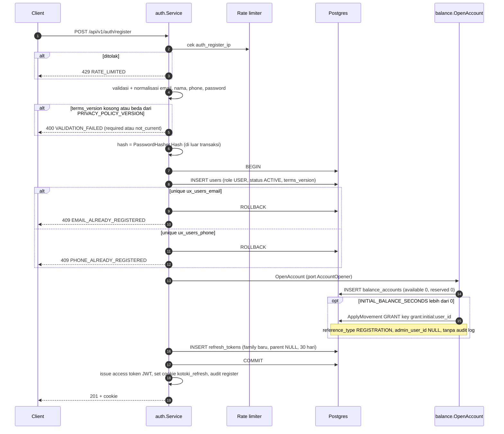

#### Login

Login menerapkan dua rate limit, verifikasi dummy untuk akun yang tidak ada, dan status `SUSPENDED` hanya terungkap setelah password benar.
Referensi: Spec §3.8.2, §3.10.

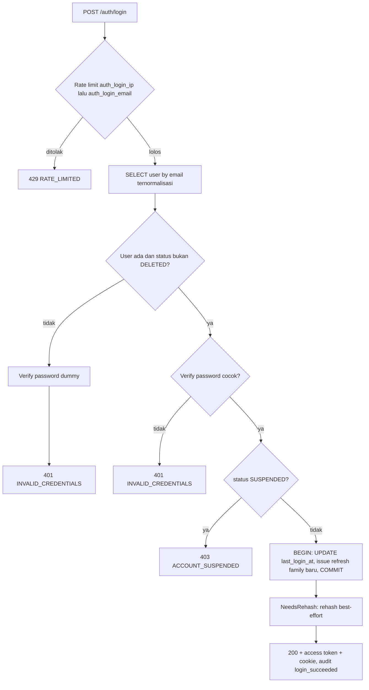

#### Refresh token: rotasi, reuse detection, grace 10 detik

Refresh memakai cookie `kotoki_refresh`, row di-lock `FOR UPDATE`, dan token lama ditandai `ROTATED` saat token baru terbit. Token yang sudah dirotasi dipakai lagi dalam 10 detik (`AUTH_REFRESH_REUSE_GRACE`) dianggap race multi-tab (409), di luar itu dianggap reuse dan seluruh family dicabut. Logout (`POST /auth/logout`) mencabut family dengan `revoke_reason = LOGOUT` dan selalu membalas 204 serta menghapus cookie.
Referensi: Spec §3.8.3, §3.8.4, D-021.

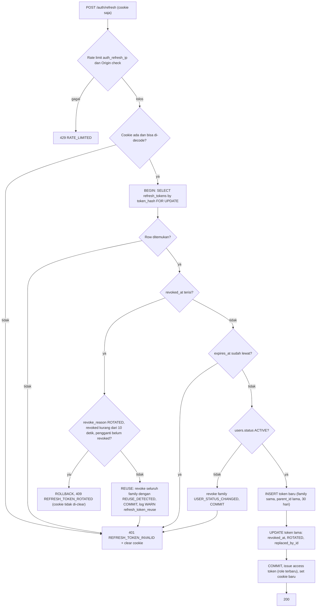

#### Forgot dan reset password

Forgot selalu membalas 202 generik agar tidak membocorkan keberadaan akun, dan email dikirim async lewat mail dispatcher in-process. Reset memakai token sekali pakai (15 menit), lalu mencabut semua refresh token user (`PASSWORD_RESET`).
Referensi: Spec §3.9.1, §3.9.2.

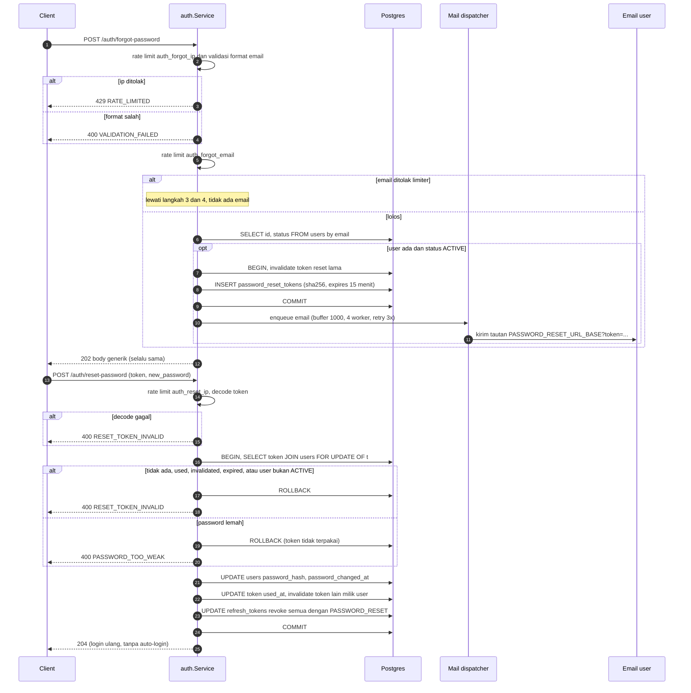

#### Hapus akun: DELETE /me

Hapus akun mengunci `balance_accounts`, lalu `users`, lalu `sessions`. Sesi `STARTING`, `ACTIVE`, atau `ENDING` menolak penghapusan, sesi `RESERVED` dibatalkan dan reservasinya dilepas dalam transaksi yang sama. Purge data dilakukan asinkron oleh job `account_purge`.
Referensi: Spec §3.13.3, §4.6.0, §4.6.2.

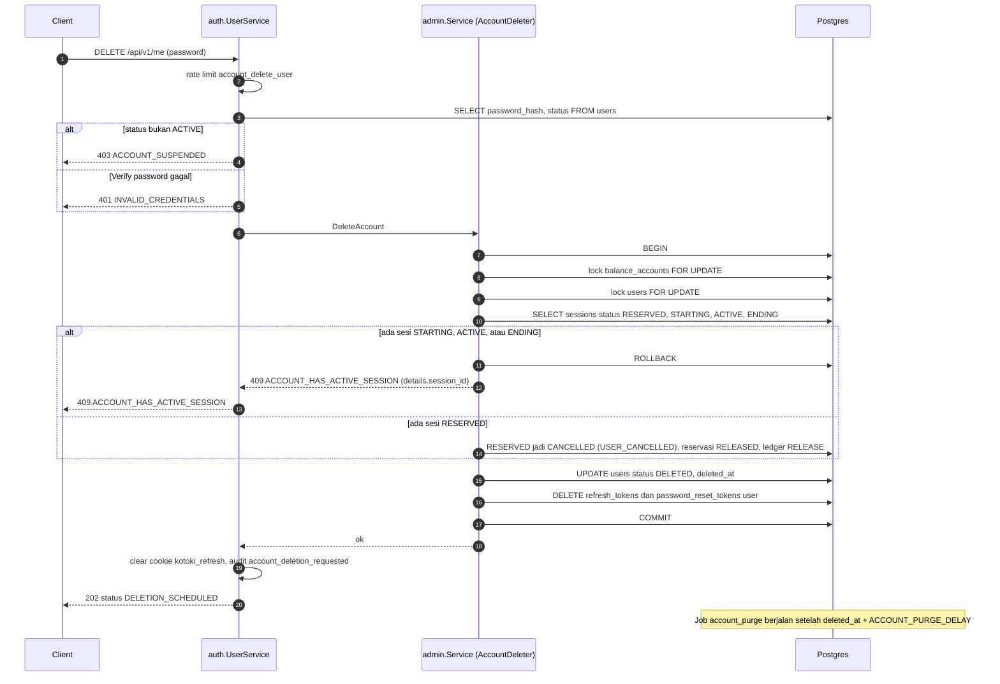

#### WebSocket ticket (D-022)

Ticket satu kali pakai (TTL 30 detik) disimpan di Redis dengan key hash dan dikonsumsi gateway realtime dengan `GETDEL`. Terms usang tidak memblokir ticket. Sesi `RESERVED` hanya boleh bila belum melewati `start_deadline_at`.
Referensi: Spec §3.11, §5.9.4, D-022.

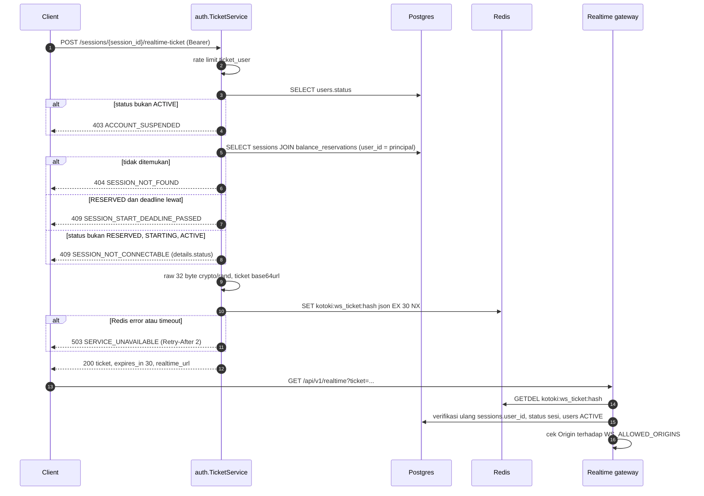

### Balance dan Ledger

#### ApplyMovement dan jenis entry ledger

Semua perubahan saldo lewat satu jalur `ApplyMovement` di bawah lock account: update `balance_accounts` lalu insert `balance_ledger` dengan `idempotency_key` deterministik. Tabel efek per transaksi mengikuti contoh reserved = 600.
Referensi: Spec §4.6.0, §4.6, §4.6.4, D-032, D-033.

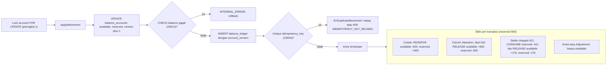

#### Grant dan adjustment admin

Grant dan adjustment butuh header `Idempotency-Key` (UUID) dan menulis ledger serta `admin_audit_logs` dalam satu transaksi. Adjustment tidak boleh membuat `available_seconds` negatif dan tidak menyentuh reservasi.
Referensi: Spec §4.6.6, §4.6.7, D-031, D-033.

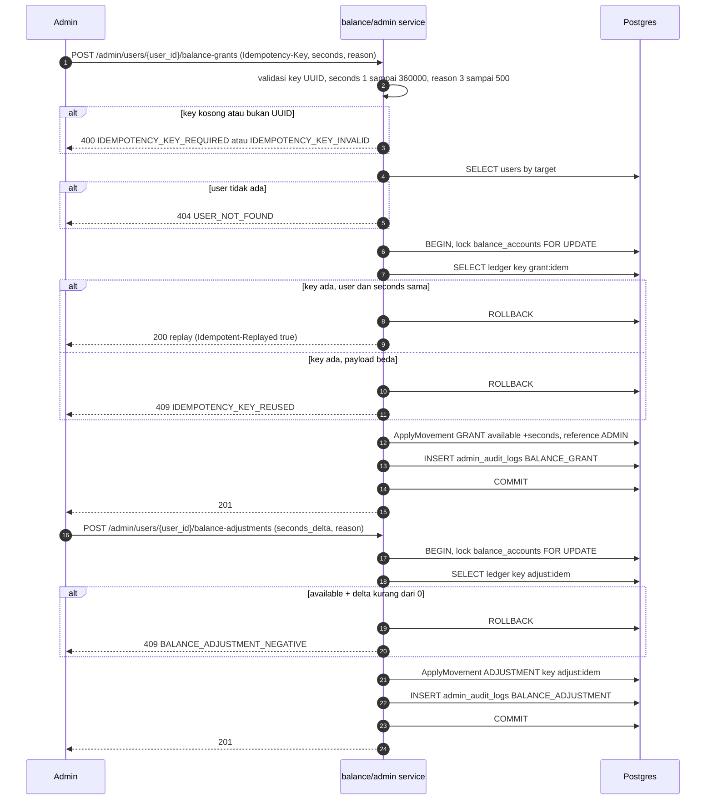

#### Rumus charge (D-036)

`billable_end` dipotong di `expires_at` dan berhenti di `ending_at` (waktu flush, grace, dan finalize tidak ditagih). Untuk `PROVIDER_FAILURE` atau `SERVER_ERROR`, aktif di bawah 60 detik tidak ditagih dan sisanya dikurangi 30 detik. Sesi yang tidak pernah `ACTIVE` selalu charge 0.
Referensi: Spec §4.5, D-036.

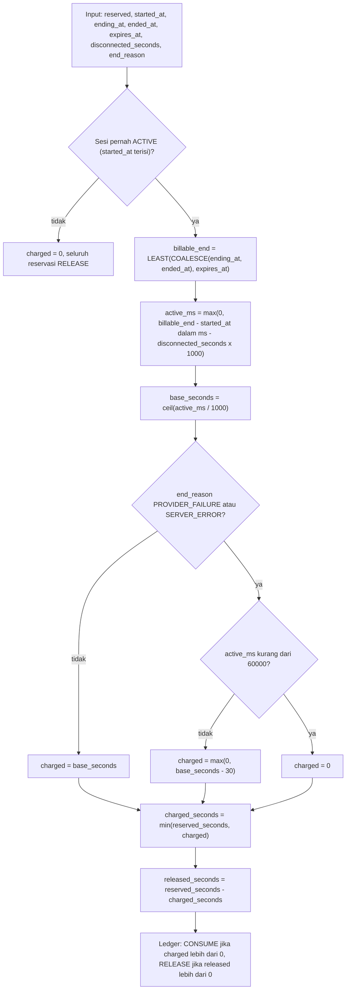

#### Rekonsiliasi balance (job balance_reconcile)

Job read-only per jam menjalankan pemeriksaan R1 sampai R6. Setiap baris hasil adalah pelanggaran: log ERROR, set gauge Prometheus, dan alert. Tidak ada auto-fix, koreksi dilakukan manual lewat adjustment.
Referensi: Spec §4.8, §4.4.

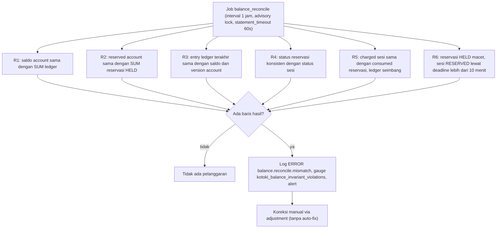

### Session Lifecycle

#### Create session dan reservasi (T1)

Transaksi create mengunci account lebih dulu sehingga request paralel user yang sama terserialisasi. Validasi user, terms, konten, dan adaptive difficulty dilakukan sebelum `BEGIN`, dan tidak ada panggilan eksternal di dalam transaksi.
Referensi: Spec §4.6.1, §5.5 (T1), §5.9.4, D-034, D-030.

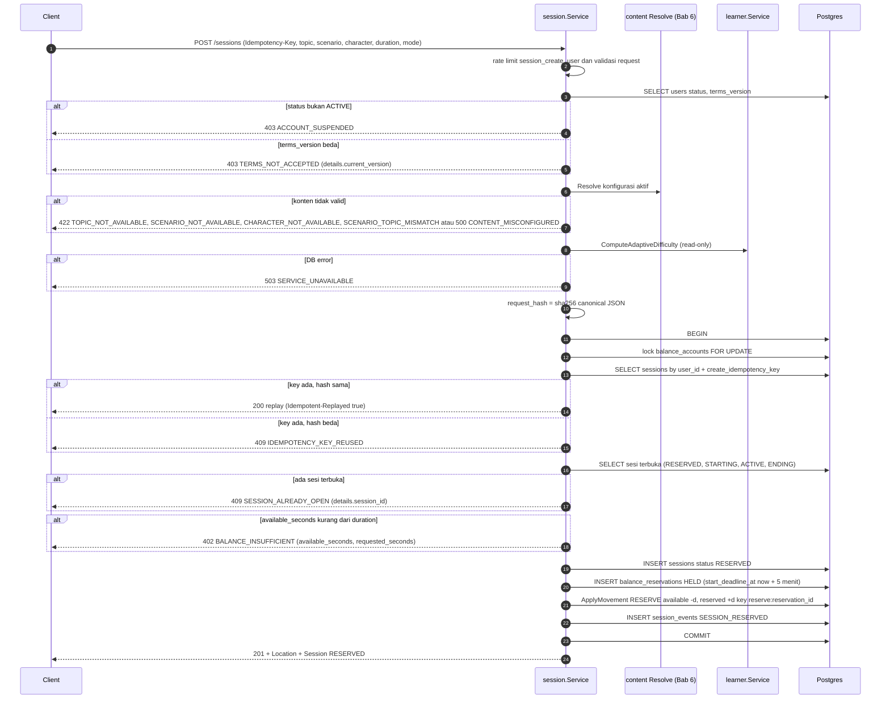

#### Diagram status sesi (T1 sampai T10)

Status sesi dan transisi sah mengikuti D-050 dan D-051. Selain transisi pada diagram, semua transisi lain (misalnya `RESERVED` ke `ACTIVE` atau `ENDING` ke `ACTIVE`) harus ditolak, dan status terminal tidak pernah berubah lagi.
Referensi: Spec §5.4, §5.5, D-050, D-051, D-052.

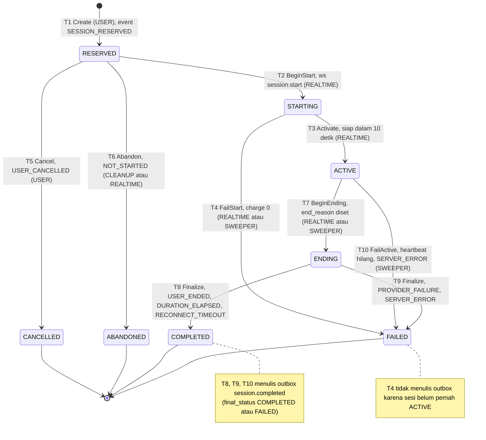

#### Cancel dan abandon (release reservasi)

Cancel (T5, oleh user) dan abandon (T6, job `reservation_cleanup` atau inline saat start terlambat) memakai rutin release yang sama: reservasi `RELEASED`, ledger `RELEASE`, `charged_seconds = 0`, `runtime_fence` naik. Job hanya menyentuh reservasi `HELD` untuk sesi `RESERVED` yang lewat deadline (D-035).
Referensi: Spec §4.6.2, §5.5 (T5, T6), D-035.

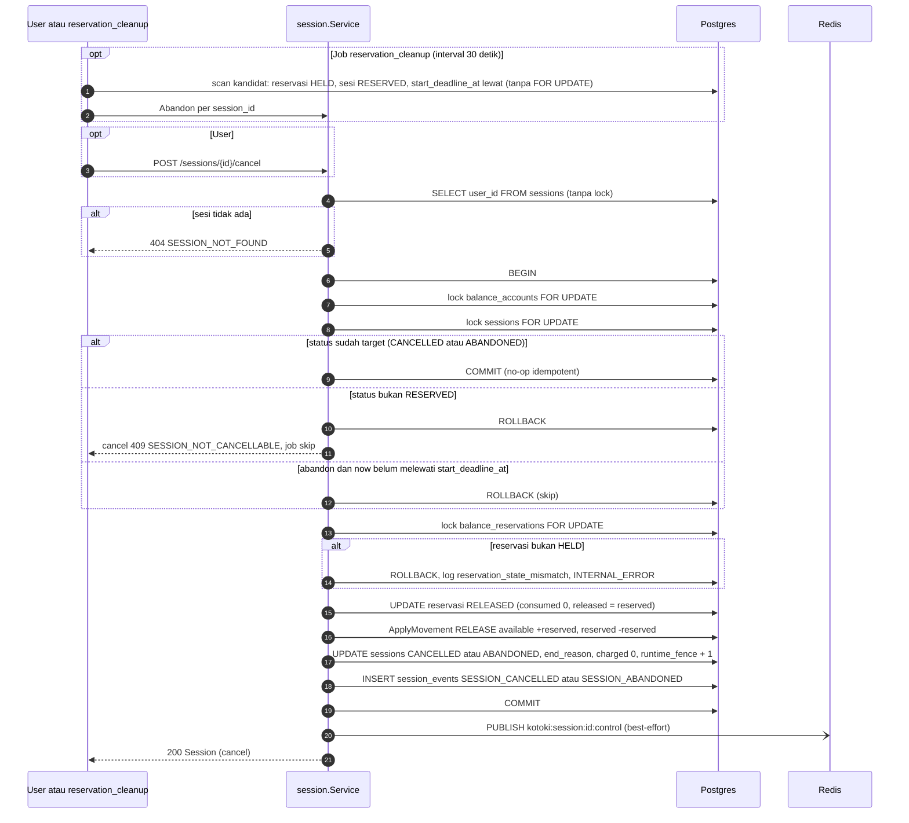

#### Start sampai ACTIVE (T2, T3, T4)

Runtime realtime mengklaim sesi lalu memindahkan `RESERVED` ke `STARTING` (transaksi terpisah), membuka provider dalam batas 10 detik, lalu `Activate` mengisi `started_at` dan `expires_at`. Kegagalan memicu `FailStart` dengan release penuh dan charge 0.
Referensi: Spec §5.5 (T2 sampai T4), §5.6.2, D-053.

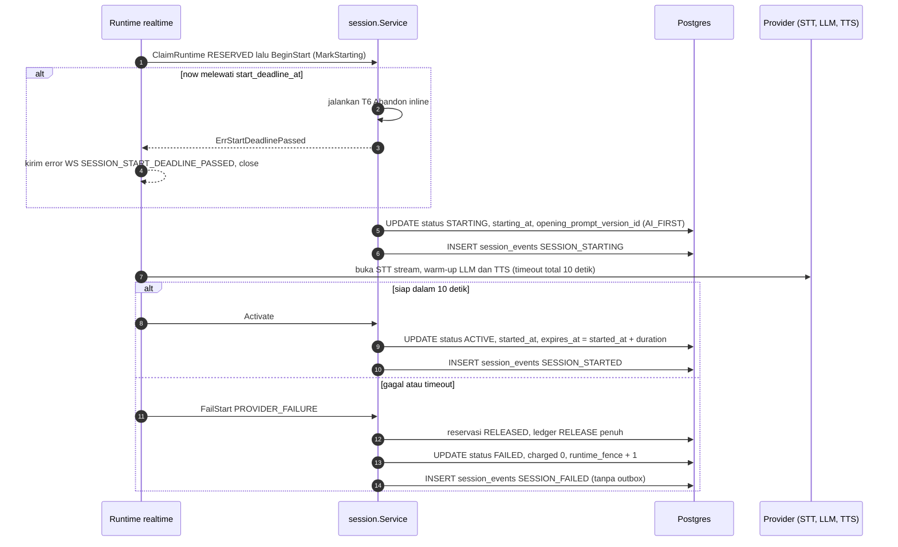

#### Settle saat sesi selesai (BeginEnding, Finalize, charge, outbox)

`BeginEnding` mengisi `ending_at` dan `end_reason` (panggilan pertama yang menang). `Finalize` menjalankan settlement dalam satu transaksi: hitung charge, `CONSUME` dan `RELEASE`, tutup turn menggantung, update status ke `COMPLETED` atau `FAILED`, tulis event dan outbox `session.completed`.
Referensi: Spec §4.6.3, §5.5 (T7 sampai T10), §5.6.3, §5.7.2, D-036.

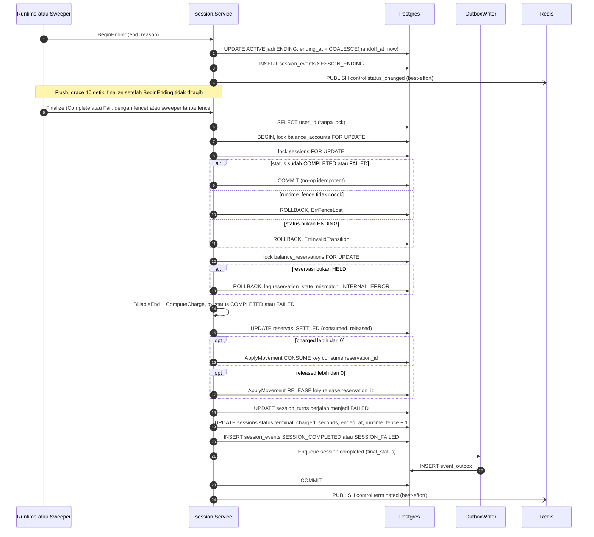

#### Aturan session sweeper (a sampai e)

Sweeper (`session_sweeper`, interval 10 detik) memakai `session.Service` yang sama dengan fence nil dan actor `SWEEPER`, satu transaksi per sesi, maksimal 200 sesi per aturan per tick. Aturan (e) dijalankan sebelum (a), dan aturan (b) punya dua pengaman.
Referensi: Spec §5.6.4, §2.6 D-054, §4.5.

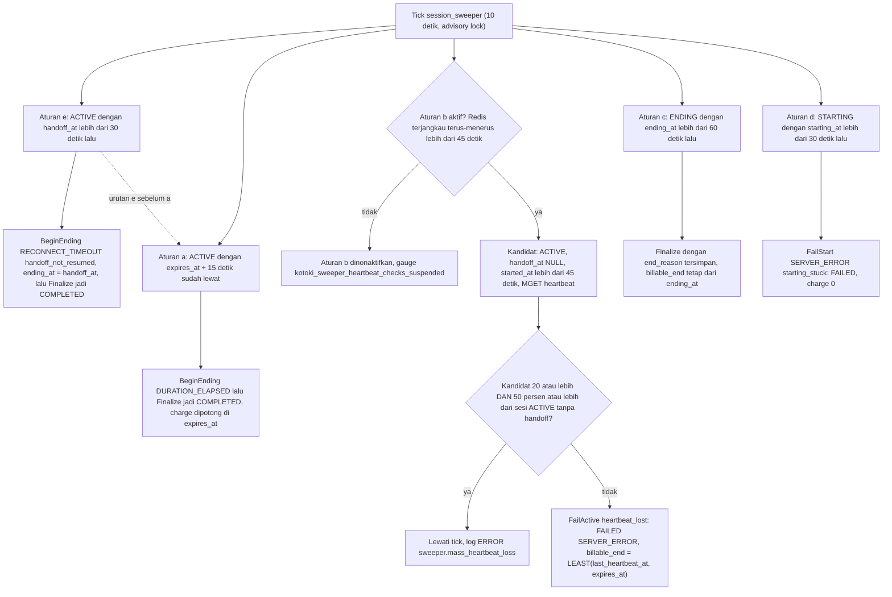

## 2. Arsitektur, Realtime, dan Provider

### Arsitektur, Realtime Gateway, dan Provider Layer

#### Arsitektur komponen

Tiga binary Go (`cmd/api`, `cmd/realtime`, `cmd/worker`) berbagi Postgres, Redis, dan RabbitMQ. Provider eksternal hanya dipanggil lewat Provider Layer (router) dari realtime dan worker; observability memakai Prometheus `/metrics` dan trace OTLP. Referensi: Spec §2.1 (D-002, D-006), §2.10 (D-090 s.d. D-094), §7.1, §8.5.2.

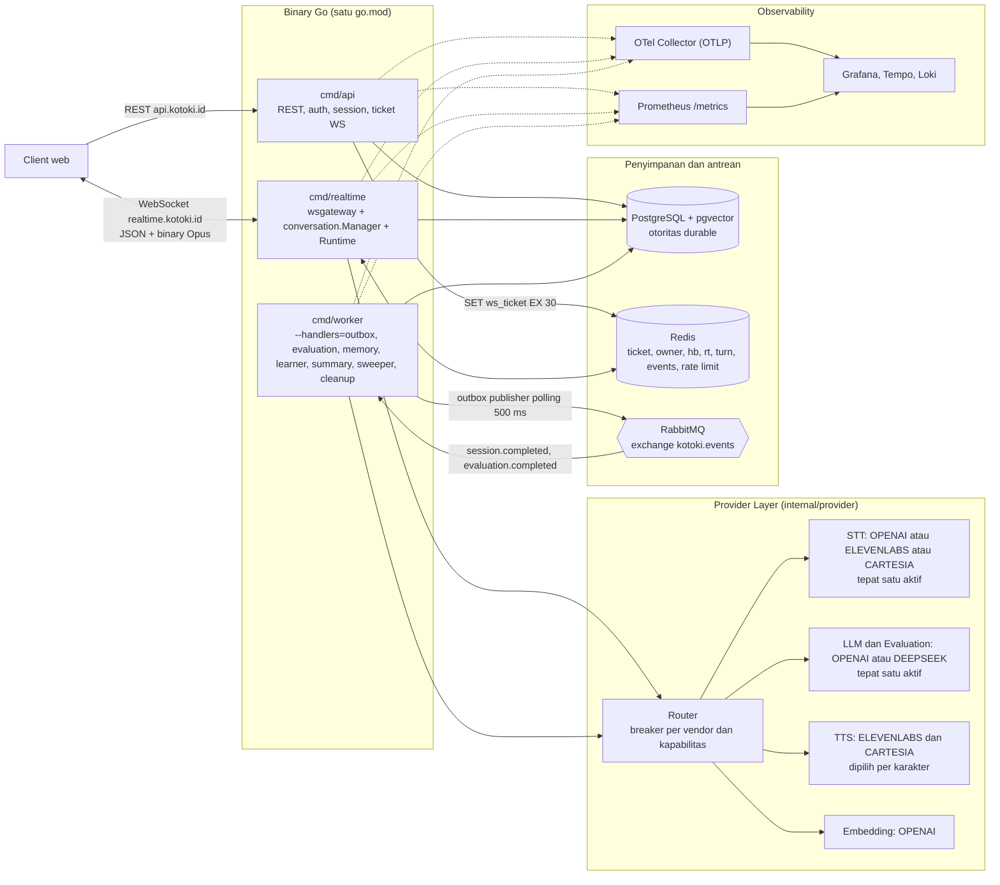

#### Handshake WebSocket: ticket, upgrade, session.ready

Ticket dibuat API dan dikonsumsi sekali pakai (`GETDEL`) oleh realtime. Pemeriksaan HTTP (langkah 1 s.d. 3) menolak tanpa upgrade; setelah upgrade, kegagalan ditolak dengan close code. Referensi: Spec §7.3.1, §7.3.2, §7.4.8, §3.11 (D-022).

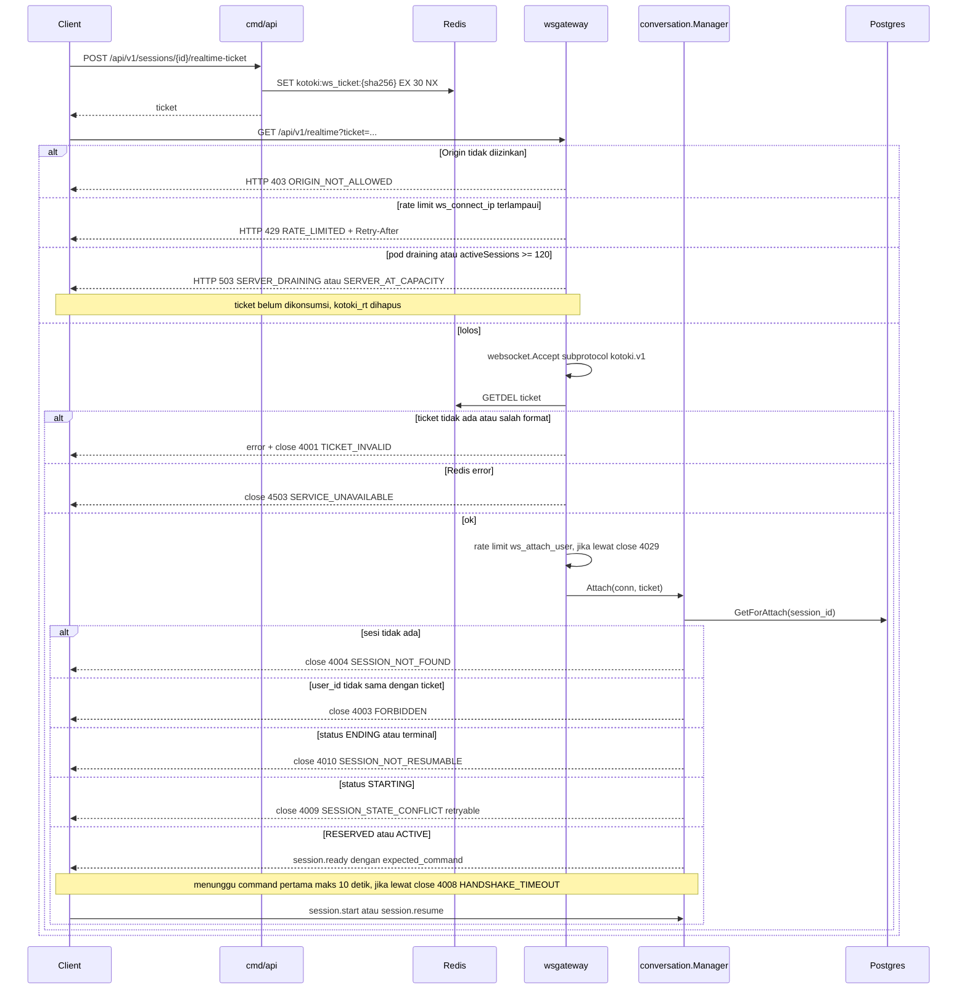

#### Start sesi: ClaimRuntime, fence, STARTING ke ACTIVE

Command `session.start` memulai klaim runtime (fence naik), transisi `RESERVED` ke `STARTING`, persiapan paralel dengan deadline 10 detik, lalu `ACTIVE`. Kegagalan membuat sesi `FAILED` dengan charge 0 dan close 4500. Referensi: Spec §7.6.3, §7.3.2, §7.9.3, D-051, D-053, S-14.

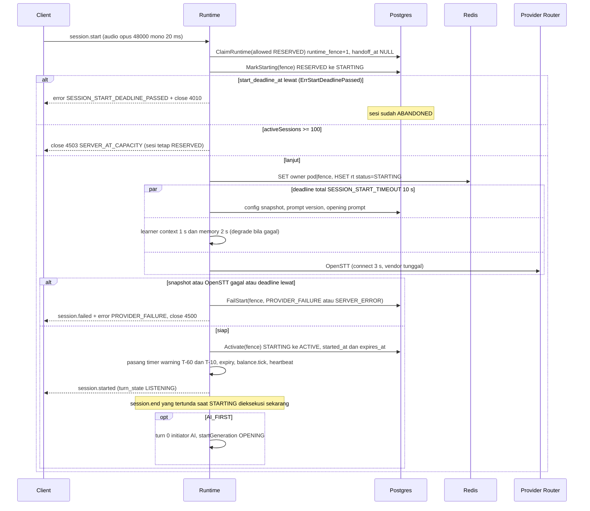

#### Status sesi dari sisi runtime

Runtime hanya memakai transisi sah D-051 lewat `session.RuntimeService` (ber-fence). Status terminal: `COMPLETED`, `CANCELLED`, `ABANDONED`, `FAILED`. Referensi: Spec §2.6 (D-050 s.d. D-055), §7.11.4.

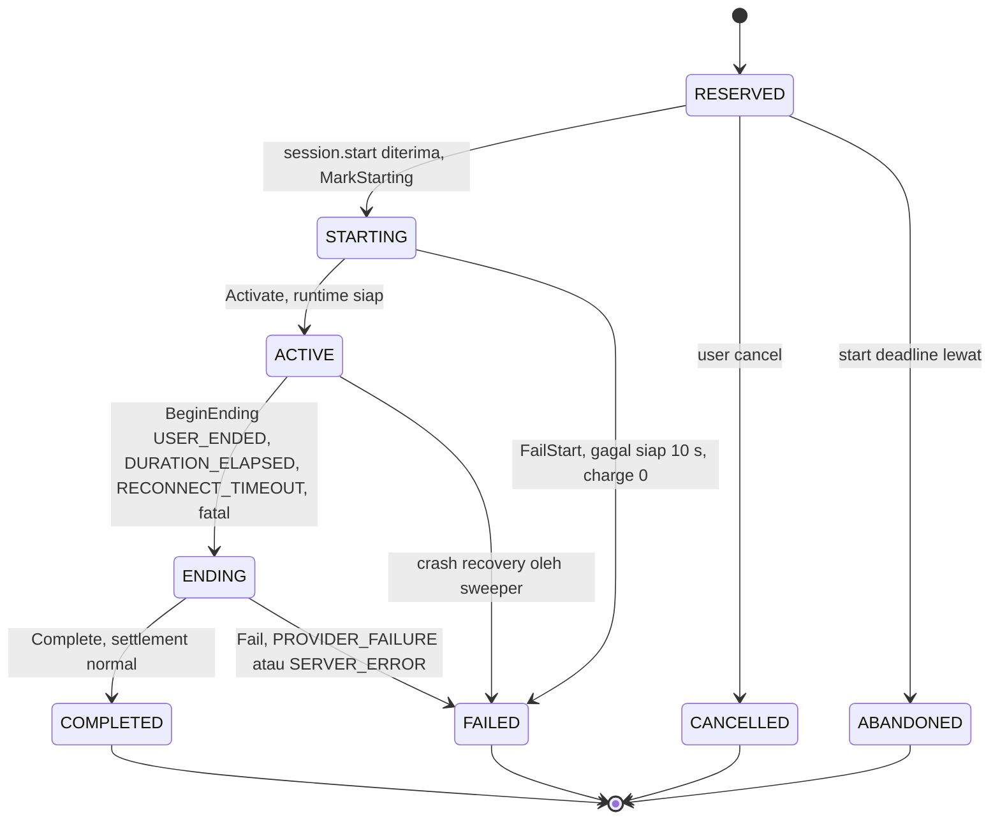

#### State machine turn (runtime)

Empat state turn runtime (D-075) dengan event utama dari detector VAD dan pipeline generation. Nomor baris merujuk tabel transisi §7.6.1. Referensi: Spec §7.6.1, §7.6.2, D-075, D-076, D-077.

```mermaid
stateDiagram-v2
  [*] --> LISTENING
  LISTENING --> USER_SPEAKING: SPEECH_CONFIRMED dan acceptingTurns (baris 1)
  USER_SPEAKING --> USER_SPEAKING: SPEECH_PAUSE atau SPEECH_RESUME (baris 5 dan 6)
  USER_SPEAKING --> PROCESSING: SILENCE_REACHED atau MAX_UTTERANCE 45 s, stt.Finalize (baris 3 dan 4)
  PROCESSING --> PROCESSING: final valid, stt.final, startGeneration REPLY (baris 7)
  PROCESSING --> LISTENING: teks discard, turn DISCARDED (baris 8)
  PROCESSING --> USER_SPEAKING: user lanjut bicara sebelum first audio, USER_RESUMED (baris 9 dan 9b)
  PROCESSING --> AI_SPEAKING: FIRST_AUDIO, ai.audio_started (baris 10)
  PROCESSING --> PROCESSING: GENERATION_FAILED REPLY, turn FAILED lalu APOLOGY (baris 11)
  PROCESSING --> LISTENING: GENERATION_FAILED OPENING (baris 12)
  AI_SPEAKING --> USER_SPEAKING: BARGE_IN_CONFIRMED, turn INTERRUPTED (baris 13)
  AI_SPEAKING --> AI_SPEAKING: AUDIO_DONE, ai.audio_completed (baris 14)
  AI_SPEAKING --> LISTENING: playback_finished atau PLAYBACK_DEADLINE, turn COMPLETED (baris 15)
  AI_SPEAKING --> PROCESSING: GENERATION_FAILED setelah first audio (baris 16)
  LISTENING --> LISTENING: WS_DISCONNECTED, detached (baris 17)
```

#### Pipeline satu turn percakapan (USER_FIRST, jalur normal)

Dari frame audio masuk sampai audio AI keluar: Opus decode ke PCM 16 kHz, VAD dan detector, STT, context builder, LLM streaming, parser kalimat, TTS per kalimat, encode Opus, pacer, dan persist turn. Target D-100: turn end ke audio pertama P95 sampai 1.500 ms. Referensi: Spec §7.5, §7.6.2, §7.6.6, §7.7.1, §7.15.2, D-071 s.d. D-081.

```mermaid
sequenceDiagram
  participant C as Client
  participant AP as audioPipeline
  participant L as Runtime.loop
  participant STT as STT (router)
  participant PS as persister
  participant G as Generation (llm, tts, pacer)
  participant LLM as LLM
  participant TTS as TTS
  participant W as writer
  loop setiap 20 ms
    C->>AP: binary 0x01 Opus 48k
    AP->>AP: decode ke PCM16 16k, VAD (mode 2)
    AP->>STT: SendAudio
    AP->>L: frameEvent voiced
  end
  Note over L: voiced 200 ms dalam 300 ms, SPEECH_CONFIRMED
  L->>PS: INSERT session_turns status NULL
  L-->>C: speech.started, turn.started USER
  STT-->>L: partial
  L-->>C: stt.partial
  Note over L: silence mencapai ambang 800 atau 1400 atau 500 ms (D-076)
  L->>STT: Finalize (commit TURN_END)
  STT-->>L: FINAL FromFinalize (timeout 1,5 s)
  L->>PS: UPDATE user_text, stt_final_ms
  L-->>C: stt.final
  L->>L: context builder dan PromptBuilder tanpa I/O
  L->>G: startGeneration REPLY, generation+1
  L-->>C: ai.generation_started
  G->>LLM: StreamLLM (first token maks 2 s)
  LLM-->>G: delta teks
  G-->>C: ai.text_delta
  G->>G: SentenceParser potong pada tanda kalimat atau 60 karakter
  G->>TTS: Synthesize kalimat 0 (PCM16 24k)
  TTS-->>G: chunk PCM
  G->>G: framer 20 ms, encode Opus
  G->>W: MarkAudioSent lalu EnqueueAudio frame pertama
  W-->>C: binary 0x02 generation seq
  G-->>L: FIRST_AUDIO
  L-->>C: ai.audio_started, ai.sentence 0
  Note over G,TTS: kalimat berikutnya di-TTS berurutan selagi LLM masih streaming
  W-->>L: AUDIO_WRITTEN_ALL
  L-->>C: ai.audio_completed
  C->>L: client.playback_finished
  L->>PS: UPDATE turn COMPLETED, assistant_text, assistant_spoken_text
  L-->>C: turn.completed
  Note over L: kembali LISTENING, tugas pasca-turn async (rolling summary, memory)
```

#### Barge-in dan interupsi AI

Barge-in terkonfirmasi bila VAD aktif sedikitnya 300 ms dan partial STT sedikitnya 2 karakter. Runtime membatalkan generation, menaikkan nomor generation, membersihkan antrean audio, lalu menyimpan turn `INTERRUPTED` dengan `assistant_spoken_text`. Jaminan server: audio terakhir ditulis dalam 150 ms (D-101). Referensi: Spec §7.6.5, §7.15.3, D-073, D-077, D-078.

```mermaid
sequenceDiagram
  participant C as Client
  participant L as Runtime.loop
  participant G as Generation N
  participant W as writer
  participant PS as persister
  participant STT as STT
  Note over L: state AI_SPEAKING, generation N
  G->>W: frame audio generation N
  W-->>C: binary 0x02 generation N
  C->>C: VAD lokal, duck atau stop playback
  C->>L: client.barge_in (hint, hanya metrik)
  C->>L: binary 0x01 suara user
  L->>STT: PCM
  STT-->>L: partial minimal 2 karakter
  Note over L: detector BARGE_IN_CONFIRMED (VAD 300 ms dalam 400 ms)
  L->>G: gen.cancel() memutus LLM, TTS, pacer
  L->>L: generation menjadi N+1, activeGen diperbarui
  L->>W: PurgeAudio, frame generation lama dibuang
  L-->>C: ai.interrupted reason BARGE_IN, active_generation N+1, spoken_sentence_count
  L->>PS: finalize turn INTERRUPTED, assistant_text penuh, assistant_spoken_text kalimat yang sudah ditulis
  L->>STT: MarkTurn(onset)
  L->>PS: INSERT turn baru status NULL
  L-->>C: speech.started during_ai_speech true, turn.started USER
  Note over L: state USER_SPEAKING
  G--xL: event terlambat generation N dibuang
  Note over C: client membuang frame dengan generation lebih kecil dari N+1
  Note over L: konteks LLM berikutnya memakai assistant_spoken_text + penanda interupsi
```

#### Disconnect, resume di pod yang sama, dan takeover pod lain

Saat koneksi putus, runtime menjadi detached: generation dibatalkan, turn berjalan `FAILED`, STT ditutup, timer sesi tetap berjalan, dan reconnect window 30 detik dimulai. Resume di pod lain memakai fence Postgres sehingga pemilik lama berhenti tanpa menulis. Referensi: Spec §7.10.1 s.d. §7.10.4, §7.9.3, D-055, D-083, D-084.

```mermaid
sequenceDiagram
  participant C as Client
  participant A as Pod A (pemilik lama)
  participant B as Pod B
  participant R as Redis
  participant PG as Postgres
  C--xA: koneksi putus
  Note over A: detach, cancel generation, turn FAILED, tutup STT, rt.connected 0
  Note over A: reconnectTimer 30 s, timer expiry tetap jalan
  C->>C: ambil ticket baru lewat REST
  C->>B: GET /api/v1/realtime?ticket=...
  B-->>C: session.ready expected_command session.resume
  C->>B: session.resume last_server_seq, audio
  alt runtime masih ada di pod ini (resume pod sama)
    B->>B: tutup koneksi lama 4011 bila masih ada, hitung disconnected
    B->>PG: AddDisconnected, batalkan reconnectTimer
    B->>B: OpenSTT ulang ke vendor aktif
  else runtime ada di pod lain (takeover)
    B->>PG: ClaimRuntime(ACTIVE) runtime_fence+1
    B->>R: owner Lua SET pod|fence, PUBLISH TAKEOVER ke pod A
    R-->>A: TAKEOVER, fence lost
    A->>A: berhenti tanpa menulis, close 4011 bila ada koneksi
    B->>R: baca rt, turn, summary
    alt sudah lewat 30 s sejak putus
      B->>PG: AddDisconnected, BeginEnding RECONNECT_TIMEOUT, Complete
      B-->>C: session.ending ENDING + session.completed, close 1000
    else dalam window
      B->>PG: FailInProgress, recent turns, max seq dan generation, AddDisconnected
      B->>B: OpenSTT, generation = max + 1
    end
  end
  B->>R: XRANGE events
  alt gap replay tersedia
    B-->>C: event durable server_seq > last_server_seq dengan replay true
    B-->>C: session.snapshot replay COMPLETE
  else gap tidak tersedia atau Redis down
    B-->>C: session.snapshot replay UNAVAILABLE
  end
  Note over B: state LISTENING, audio tidak pernah di-replay
```

#### Heartbeat, timeout koneksi, dan slow consumer

Server mengirim ping tiap 15 detik dan menganggap koneksi putus setelah 45 detik tanpa aktivitas. Antrean outbound 256 pesan yang penuh memicu `SLOW_CONSUMER`. Pelanggaran protokol berakhir close 1008. Referensi: Spec §7.4.10, §7.12.3, §7.10.1, D-082.

```mermaid
flowchart TD
  A["Koneksi WS aktif"] --> B["heartbeat: conn.Ping tiap 15 s"]
  A --> RD["reader: tiap frame masuk memperbarui lastActivity"]
  B --> C{"now - lastActivity lebih dari 45 s?"}
  C -->|"ya"| D["close 4102 HEARTBEAT_TIMEOUT (best effort)"]
  C -->|"tidak"| A
  RD --> V{"rate atau ukuran frame melanggar?<br/>binary 100/s burst 200, JSON 20/s burst 40,<br/>frame JSON lebih dari 16 KiB, binary lebih dari 4 KiB"}
  V -->|"ya"| E["error PROTOCOL_VIOLATION, close 1008"]
  V -->|"tidak"| A
  A --> F{"Outbound 256 pesan penuh,<br/>event durable tidak muat?"}
  F -->|"ya"| G["close 4101 SLOW_CONSUMER"]
  A --> H{"write socket lebih dari 5 s?"}
  H -->|"ya"| I["disconnect"]
  D --> J["alur disconnect: runtime detached"]
  G --> J
  I --> J
  E --> K["koneksi ditutup, client tidak reconnect"]
  J --> L["reconnectTimer 30 s, timer sesi tetap berjalan, balance.tick berhenti"]
  L --> M{"client resume dalam 30 s?"}
  M -->|"ya"| N["resume atau takeover, detik terputus dikurangkan dari charge"]
  M -->|"tidak"| O["AddDisconnected lalu BeginEnding RECONNECT_TIMEOUT"]
```

#### Graceful shutdown: drain dan handoff (DRAIN_RELEASE)

Saat SIGTERM pod menolak koneksi baru (HTTP 503) dan setiap runtime menunggu safepoint sebelum handoff: flush persister dan Redis, `MarkHandoff`, event `OWNER_CHANGED DRAIN_RELEASE`, release owner, lalu close 4100. Sesi yang tidak di-resume ditutup sweeper aturan (e). Referensi: Spec §7.12.1, §2.6 (D-054), §7.9.2.

```mermaid
sequenceDiagram
  participant K as Kubernetes
  participant P as Pod realtime
  participant L as Runtime.loop
  participant PS as persister
  participant R as Redis
  participant PG as Postgres
  participant C as Client
  participant S as session_sweeper
  K->>P: SIGTERM (preStop sleep 5)
  P->>P: draining true, readyz 503, podinfo.draining 1
  P->>L: ctl DRAIN ke setiap Runtime
  alt STARTING
    L->>L: selesaikan start maks 10 s lalu perlakukan sebagai ACTIVE
  else ENDING
    L->>L: selesaikan finish() normal
  else ACTIVE terhubung
    L->>L: tunggu safepoint LISTENING tanpa turn, maks 20 s
    Note over L: lewat 20 s, cancel generation dan turn berjalan FAILED
  else ACTIVE detached
    L->>L: langsung handoff
  end
  L->>PS: tunggu persister kosong (maks 5 s)
  L->>R: flush sinkron rt connected 0, turn, summary, hb
  L->>PG: MarkHandoff(fence) sessions.handoff_at = now
  L->>PS: session_events OWNER_CHANGED reason DRAIN_RELEASE
  L->>R: release owner (Lua)
  L-->>C: error SERVER_DRAINING lalu close 4100
  Note over L: runtime berhenti, sesi tetap ACTIVE, hb tidak ditulis lagi
  C->>C: ticket baru, reconnect segera tanpa backoff
  Note over C,R: takeover di pod lain, handoff_at di-NULL-kan oleh ClaimRuntime
  opt tidak pernah di-resume
    S->>PG: aturan (e) ACTIVE dan handoff_at lebih dari 30 s lalu
    S->>PG: BeginEnding RECONNECT_TIMEOUT, billable_end = handoff_at
  end
```

#### Provider router: pemilihan vendor per kapabilitas

STT, LLM, Evaluation, dan Embedding memakai tepat satu vendor aktif dari env tanpa fallback. Hanya TTS memilih vendor per karakter, dengan fallback opsional lewat `voice.fallback`. Circuit breaker, semaphore konkurensi, dan timeout budget diterapkan sebelum memanggil adapter. Referensi: Spec §8.5.1 s.d. §8.5.6, §8.6.1, D-017, D-040, D-042, D-043.

```mermaid
flowchart TD
  REQ["Panggilan provider dari Runtime atau Worker"] --> CAP{"Kapabilitas?"}
  CAP -->|"STT, LLM, EVALUATION, EMBEDDING"| ONE["Vendor = satu-satunya adapter aktif<br/>flag enabled di env, ganti vendor = ubah env + restart"]
  CAP -->|"TTS"| VS["VoiceSelection dari config_snapshot karakter<br/>Primary: provider_name, model_name, voice_id"]
  VS --> PRI{"Breaker TTS primary OPEN<br/>dan ada voice.fallback<br/>dan PROVIDER_TTS_FALLBACK_ENABLED?"}
  PRI -->|"ya"| FB["Pakai voice.fallback<br/>used_fallback true, reason CIRCUIT_OPEN"]
  PRI -->|"tidak"| PV["Pakai primary karakter"]
  ONE --> BRK
  FB --> BRK
  PV --> BRK
  BRK{"breaker(vendor, kapabilitas).Allow()?"}
  BRK -->|"tidak"| CO["Error UNAVAILABLE circuit_open, fail-fast"]
  BRK -->|"ya"| SEM{"semaphore tersedia?<br/>STT 125, LLM 60, TTS 80 per pod"}
  SEM -->|"tidak"| RL["Error RATE_LIMITED local_concurrency<br/>(tidak dihitung breaker)"]
  SEM -->|"ya"| CALL["Panggil adapter dengan timeout budget<br/>STT connect 3 s, LLM first token 2 s dan total 15 s,<br/>TTS first audio 1,5 s dan 10 s per kalimat"]
  CALL --> RES{"Hasil"}
  RES -->|"sukses"| OK["ticket.Done(nil), stream diteruskan, health tracker dan metrik"]
  RES -->|"gagal"| ERR["ticket.Done(err), error ter-normalisasi<br/>TIMEOUT, RATE_LIMITED, AUTH, INVALID_REQUEST,<br/>UNAVAILABLE, CONTENT_FILTERED, INVALID_RESPONSE, CANCELLED"]
  CO --> FAIL["Runtime: GENERATION_FAILED atau STT error<br/>lihat diagram kegagalan provider"]
  RL --> FAIL
  ERR --> FAIL
```

#### Circuit breaker per (vendor, kapabilitas)

Breaker in-memory per proses: terbuka setelah 5 kegagalan terhitung dalam 30 detik, half-open setelah 20 detik dengan satu probe. `CANCELLED` dan `CONTENT_FILTERED` tidak dihitung. Referensi: Spec §8.5.4, §8.3, D-043.

```mermaid
stateDiagram-v2
  [*] --> CLOSED
  CLOSED --> CLOSED: sukses atau kegagalan tidak dihitung
  CLOSED --> OPEN: kegagalan terhitung mencapai 5 dalam window 30 s
  OPEN --> OPEN: Allow ditolak sebelum 20 s, circuit_open
  OPEN --> HALF_OPEN: Allow setelah 20 s, satu probe diizinkan
  HALF_OPEN --> HALF_OPEN: Allow saat probe inflight ditolak
  HALF_OPEN --> CLOSED: probe sukses, window direset
  HALF_OPEN --> OPEN: probe gagal terhitung, openedAt diperbarui
```

#### Fallback TTS (voice.fallback) dan kegagalan provider menjadi APOLOGY atau PROVIDER_FAILURE

Fallback TTS hanya terjadi sebelum audio pertama generation terkirim; vendor dan voice dipin per generation sehingga runtime mensintesis ulang semua kalimat setelah `TTSEpochChanged`. STT/LLM tidak punya fallback: kegagalan generation menghasilkan turn `FAILED` dan APOLOGY, sedangkan kegagalan STT atau tiga turn gagal berturut-turut mengakhiri sesi dengan `PROVIDER_FAILURE`. Referensi: Spec §7.7.4, §7.7.6, §7.6.1, §7.11.4, §8.5.7, §8.5.8, D-042, D-080.

```mermaid
flowchart TD
  subgraph TTSF["Fallback TTS per generation"]
    T0["Synthesize kalimat dengan voice primary"] --> T1{"Gagal sebelum chunk pertama,<br/>timeout first audio, atau stream putus?"}
    T1 -->|"tidak"| T9["Audio berjalan normal"]
    T1 -->|"ya"| T2{"audioSent false<br/>dan FallbackEligible(err)<br/>dan voice.fallback ada<br/>dan belum di fallback?"}
    T2 -->|"ya"| T3["switchTTS ke voice.fallback<br/>ttsEpoch+1, used_fallback true<br/>error tts_provider_switched"]
    T3 --> T4["Runtime membuang frame belum terkirim<br/>dan Synthesize ulang semua kalimat dari 0"]
    T2 -->|"tidak (CONTENT_FILTERED, CANCELLED, audio sudah terkirim,<br/>atau tanpa fallback)"| GF
  end

  subgraph FAILP["Kegagalan generation dan sesi"]
    LL["LLM error, timeout, circuit_open, CONTENT_FILTERED"] --> GF
    GF["GENERATION_FAILED"] --> AF{"Setelah audio pertama?"}
    AF -->|"tidak (baris 11)"| TF["turn FAILED, error AI_GENERATION_FAILED<br/>startGeneration APOLOGY"]
    AF -->|"ya (baris 16)"| IN["ai.interrupted GENERATION_FAILED<br/>turn FAILED, startGeneration APOLOGY"]
    TF --> CNT
    IN --> CNT
    CNT{"Penyebab CONTENT_FILTERED?"}
    CNT -->|"ya"| CF["contentFilteredTurns+1<br/>tidak memengaruhi consecutiveFailedTurns"]
    CNT -->|"tidak"| CF2["consecutiveFailedTurns+1"]
    CF2 --> MX{"mencapai 3?"}
    MX -->|"ya"| PF
    MX -->|"tidak"| NEXT["kembali LISTENING setelah APOLOGY"]
    TR["LLM total 15 s atau deadline sesi setelah audio terkirim"] --> TRN["DONE TRUNCATED, turn COMPLETED<br/>bukan kegagalan"]
    STE["STT error saat ACTIVE: error vendor,<br/>rotasi gagal, atau 3x final timeout"] --> PF
    STO["OpenSTT gagal saat STARTING"] --> FS["FailStart STARTING ke FAILED, charge 0"]
    PF["BeginEnding PROVIDER_FAILURE lalu Fail<br/>session.ending ENDING, session.failed,<br/>error PROVIDER_FAILURE, close 4500"]
    FS --> PF2["session.failed, close 4500"]
  end
```

#### Akhir sesi dari sisi runtime

Tiga jalur akhir normal dan satu jalur fatal: durasi habis (`DURATION_ELAPSED` dengan grace 10 detik), `session.end` user (`USER_ENDED`), reconnect timeout, dan kegagalan fatal. Semuanya melalui `BeginEnding`, penyelesaian turn, tunggu persister, lalu `Complete` atau `Fail`, yang menerbitkan outbox `session.completed` bila sesi pernah `ACTIVE`. Referensi: Spec §7.11.1 s.d. §7.11.4, §7.10.1, D-052, D-055, D-091.

```mermaid
flowchart TD
  ST["Sesi ACTIVE"] --> W1["expires_at - 60 s dan - 10 s:<br/>session.ending stage WARNING"]
  W1 --> EXP{"Pemicu akhir"}
  ST --> EXP
  EXP -->|"expires_at tercapai"| E1["acceptingTurns false<br/>BeginEnding DURATION_ELAPSED<br/>graceDeadline = expires_at + 10 s"]
  EXP -->|"session.end USER_ENDED"| E2["acceptingTurns false<br/>BeginEnding USER_ENDED<br/>session.ending ENDING grace 2 s"]
  EXP -->|"reconnectTimer 30 s habis"| E3["AddDisconnected<br/>BeginEnding RECONNECT_TIMEOUT"]
  EXP -->|"fatal: STT gagal, 3 turn gagal, panic,<br/>persister gagal lebih dari 30 s"| E4["turn berjalan FAILED<br/>BeginEnding PROVIDER_FAILURE atau SERVER_ERROR"]
  E1 --> S1{"State turn saat expiry"}
  S1 -->|"LISTENING"| FIN
  S1 -->|"USER_SPEAKING"| S2["tunggu turn end atau grace, Finalize<br/>turn COMPLETED user saja"]
  S1 -->|"PROCESSING"| S3["batalkan generation, ai.interrupted SESSION_ENDING<br/>turn COMPLETED user saja atau DISCARDED"]
  S1 -->|"AI_SPEAKING"| S4["llmCancel, kalimat terparse tetap diputar<br/>COMPLETED bila LLM selesai, selain itu INTERRUPTED"]
  S2 --> FIN
  S3 --> FIN
  S4 --> FIN
  E2 --> U1["generation aktif: cancel, ai.interrupted SESSION_ENDING<br/>USER_SPEAKING: Finalize, tunggu final 1,5 s"]
  U1 --> FIN
  E3 --> FIN
  E4 --> FAILP["tunggu persister maks 5 s lalu Fail(reason)"]
  FAILP --> FO["emit session.ending ENDING, session.failed + error<br/>close 4500 atau 1011"]
  FIN["finish(): tunggu persister kosong maks 5 s,<br/>AddDisconnected bila masih terputus"]
  FIN --> CMP["Complete(fence): ENDING ke COMPLETED + settlement + outbox"]
  CMP --> CO["emit session.completed, close 1000<br/>release owner, rt.status COMPLETED, hapus dari registry"]
  CMP --> OB["event_outbox session.completed ke RabbitMQ kotoki.events<br/>evaluation, memory, summary worker"]
  FO --> OB2["session.completed dengan final_status FAILED<br/>hanya bila started_at tidak NULL"]
  GR["graceDeadline tercapai"] -.-> CUT["gen.cancel, turn berjalan INTERRUPTED atau COMPLETED, finish()"]
  CUT -.-> FIN
```

## 3. Konten, Event, Worker, dan Operasi

### Konten, Messaging, Worker Pasca-Sesi, Jobs, dan Infrastruktur

#### Lifecycle version konten (scenario dan prompt)

Version scenario/prompt bersifat immutable dan hanya berpindah status `DRAFT`, `PUBLISHED`, `RETIRED`. Partial unique index menjamin maksimal satu `PUBLISHED` per induk, sehingga publish selalu me-retire `PUBLISHED` lama lebih dulu dalam transaksi yang sama. Transisi lain (mis. `PUBLISHED` ke `DRAFT`) ditolak oleh trigger `content_version_guard` dan service.

Referensi: Spec §6.2, §6.4, D-060, D-014.

```mermaid
stateDiagram-v2
    direction LR
    [*] --> DRAFT: admin create draft atau seed
    DRAFT --> PUBLISHED: publish (published_at = now)
    DRAFT --> [*]: admin delete draft (DELETE baris)
    PUBLISHED --> RETIRED: retire atau tergantikan publish lain (retired_at = now)
    RETIRED --> PUBLISHED: publish ulang = rollback cepat (retired_at = NULL)
    note right of PUBLISHED
        Maks satu PUBLISHED per induk (partial unique index).
        Publish baru me-retire PUBLISHED lama
        di transaksi yang sama, lebih dulu.
    end note
    note left of DRAFT
        Transisi lain DITOLAK (trigger + service),
        mis. PUBLISHED ke DRAFT atau
        DELETE baris non-DRAFT.
    end note
```

#### Admin publish dan rollback version

Endpoint admin publish berjalan dalam satu transaksi: kunci induk, kunci version, validasi publish, retire `PUBLISHED` lama, publish yang baru, tulis `admin_audit_logs`. Rollback cepat adalah publish ulang version `RETIRED` lewat endpoint yang sama.

Referensi: Spec §6.13.1, §6.2, §6.10.

```mermaid
sequenceDiagram
    autonumber
    participant A as Admin (role ADMIN)
    participant API as kotoki-api
    participant V as Validator
    participant DB as PostgreSQL
    participant C as Cache lokal pod

    A->>API: POST /api/v1/admin/content/{family}/{parent}/versions/{vid}/publish
    API->>DB: BEGIN
    API->>DB: SELECT induk FOR UPDATE (scenarios atau prompt_configs)
    API->>DB: SELECT version FOR UPDATE (id dan parent_fk)
    alt version tidak ada
        API-->>A: 404 NOT_FOUND
    else sudah PUBLISHED
        API-->>A: 200 idempoten tanpa perubahan
    else DRAFT atau RETIRED
        API->>V: ValidatePublish(family, version_id) dalam tx yang sama
        alt ada issue severity ERROR
            API->>DB: ROLLBACK
            API-->>A: 422 CONTENT_VALIDATION_FAILED
        else lolos
            API->>DB: UPDATE versions SET RETIRED, retired_at = now WHERE PUBLISHED lama
            API->>DB: UPDATE versions SET PUBLISHED, published_at = now, retired_at = NULL WHERE id = vid
            API->>DB: INSERT admin_audit_logs (CONTENT_VERSION_PUBLISHED)
            API->>DB: COMMIT
            API->>C: invalidate cache lokal
            API-->>A: 200 version, retired_version_id, warnings
        end
    end
    Note over A,C: Rollback cepat = publish ulang version RETIRED. Pod lain konsisten setelah paling lama CONTENT_CACHE_TTL_SECONDS (30 s).
```

#### ContentResolver saat POST /sessions dan config_snapshot

`session.Service.Create` memanggil `Resolve` sebelum transaksi balance (read-only). Hasilnya adalah ID version scenario dan prompt `CONVERSATION` yang `PUBLISHED`, plus snapshot karakter dan formality yang disimpan di `sessions.config_snapshot`. Sesi memuat konfigurasi lewat ID atau snapshot tanpa filter status, sehingga retire atau edit konten setelahnya tidak memengaruhi sesi.

Referensi: Spec §6.9, §6.3.5, D-064.

```mermaid
flowchart TD
    IN["POST /api/v1/sessions<br/>topic_id, scenario_id, character_id"] --> T{"topic ACTIVE?"}
    T -- "tidak" --> E1["422 TOPIC_NOT_AVAILABLE"]
    T -- "ya" --> S{"scenario ACTIVE?"}
    S -- "tidak" --> E2["422 SCENARIO_NOT_AVAILABLE"]
    S -- "ya" --> M{"scenario.topic_id = topic.id?"}
    M -- "tidak" --> E3["422 SCENARIO_TOPIC_MISMATCH"]
    M -- "ya" --> SV{"ada scenario_version PUBLISHED?"}
    SV -- "tidak" --> E2
    SV -- "ya" --> CH{"character ACTIVE?"}
    CH -- "tidak" --> E4["422 CHARACTER_NOT_AVAILABLE"]
    CH -- "ya" --> TTS{"TTS mode fake?"}
    TTS -- "ya, lewati cek TTS" --> PR
    TTS -- "tidak" --> TC{"vendor enabled, model_name dan voice_id valid, bukan PLACEHOLDER_?"}
    TC -- "tidak" --> E5["500 CONTENT_MISCONFIGURED"]
    TC -- "ya" --> FB["cek voice.fallback: bila hilang maka WARN + metrik, tidak memblokir"]
    FB --> PR{"prompt CONVERSATION PUBLISHED?"}
    PR -- "tidak" --> E5
    PR -- "ya" --> LLM{"model LLM global terkonfigurasi?"}
    LLM -- "tidak" --> E5
    LLM -- "ya" --> SNAP["Bangun SessionSnapshot:<br/>karakter (id, code, name, persona, provider_name, model_name, voice_id, voice) + formality"]
    SNAP --> OUT["ResolvedConfig: topic.id, scenario.id, scenario_version.id,<br/>character.id, prompt_version.id, snapshot"]
    OUT --> TX["Transaksi balance D-034 lalu INSERT sessions<br/>(scenario_version_id, prompt_version_id, config_snapshot)"]
    NOTE["OPENING tidak diperiksa di sini. BeginStart memilihnya,<br/>bila tidak ada PUBLISHED maka opening_prompt_version_id NULL + fallback opening_line"] -.-> OUT
```

#### Transactional outbox, publisher, dan topologi RabbitMQ

Transaksi bisnis menulis `event_outbox` (PENDING) bersama perubahan domain. Publisher (`worker --handlers=outbox`) polling dengan `FOR UPDATE SKIP LOCKED`, publish ke exchange `kotoki.events` dengan publisher confirm. Setiap queue utama punya empat retry queue dan satu DLQ. Event tanpa binding masuk alternate exchange.

Referensi: Spec §9.1, §9.3, §9.6, D-090, D-091, D-092.

```mermaid
flowchart LR
    subgraph BIZ["Transaksi bisnis (API, Realtime, Worker)"]
        DOM["Perubahan domain<br/>mis. ENDING ke COMPLETED"] --> OB[("event_outbox<br/>status PENDING")]
    end
    OB -- "polling 500 ms, batch 100,<br/>SKIP LOCKED" --> PUB["Outbox publisher<br/>(worker handler outbox)"]
    PUB -- "persistent + confirm,<br/>ack lalu PUBLISHED,<br/>nack lalu attempts+1, backoff, FAILED di 10" --> EX{{"kotoki.events<br/>(topic, routing key = event_type)"}}
    EX -- "session.completed" --> QE["evaluation.session_completed"]
    EX -- "session.completed" --> QM["memory.session_completed"]
    EX -- "session.completed" --> QS["summary.session_completed"]
    EX -- "evaluation.completed" --> QL["learner.evaluation_completed"]
    EX -- "tanpa binding:<br/>evaluation.failed, memory.extracted" --> UNR[("kotoki.events.unrouted<br/>(alternate exchange, TTL 3 hari)")]
    QE --> WE["Evaluation worker"]
    QM --> WM["Memory worker"]
    QS --> WS["Summary worker"]
    QL --> WL["Learner worker"]
    WE -. "evaluation.completed via outbox" .-> OB
    WE -- "gagal retryable" --> RX{{"kotoki.retry"}}
    RX --> RQ["Q.retry.5s / 30s / 2m / 10m<br/>(TTL per queue)"]
    RQ -- "TTL habis, DLX" --> RQX{{"kotoki.requeue"}}
    RQX -- "routing key = queue asal" --> QE
    WE -- "non-retryable atau retry habis" --> DLX{{"kotoki.dlx"}}
    DLX --> DLQ[("Q.dlq<br/>replay manual: worker dlq-replay")]
```

#### Consumer dengan processed_events (idempotensi) dan klasifikasi error

Framework consumer men-decode envelope, melakukan pre-check `IsProcessed`, lalu menjalankan handler dengan timeout. Efek bisnis harus ditulis dalam satu transaksi bersama `MarkProcessed`; duplikat gagal di `ErrAlreadyProcessed` dan di-ACK. Error retryable dipublish ulang ke retry queue (maksimal 4 retry), error permanen langsung ke DLQ.

Referensi: Spec §9.7.1 sampai §9.7.4, D-093.

```mermaid
sequenceDiagram
    autonumber
    participant Q as Queue Q (quorum)
    participant C as Consumer framework
    participant H as Handler fitur
    participant DB as PostgreSQL
    participant RX as kotoki.retry
    participant DLX as kotoki.dlx

    Q->>C: deliver message (header x-retry-count opsional)
    C->>C: decode envelope, cek event_type dan event_version
    alt decode atau versi tidak didukung
        C->>DLX: publish ke DLX (x-error-class DECODE_ERROR)
        C->>Q: ACK
    else valid
        C->>DB: IsProcessed(consumer, event_id)
        alt sudah diproses
            C->>Q: ACK (result duplicate)
        else belum
            C->>H: Handle(ctx, delivery) dengan timeout handler
            H->>DB: kerja mahal di luar transaksi (LLM, embedding)
            H->>DB: BEGIN, MarkProcessed (INSERT processed_events ON CONFLICT DO NOTHING)
            alt ErrAlreadyProcessed
                H->>DB: ROLLBACK
                H-->>C: ErrAlreadyProcessed
                C->>Q: ACK
            else baru
                H->>DB: write domain + tx.Outbox().Enqueue(event berikutnya)
                H->>DB: COMMIT
                H-->>C: nil
                C->>Q: ACK
            end
        end
        opt Handle mengembalikan error
            C->>C: Classify(err)
            alt ClassDead (PermanentError, provider non-retryable, constraint 22/23)
                C->>H: OnFailure(final=true)
                C->>DLX: publish dengan confirm lalu ACK
            else ClassRetry dan retry_count kurang dari 4
                C->>H: OnFailure(final=false)
                C->>RX: publish salinan ke Q.retry.(5s, 30s, 2m, 10m) lalu ACK
            else ClassRetry dan retry habis
                C->>H: OnFailure(final=true)
                C->>DLX: publish dengan confirm lalu ACK
            else ClassRequeue (shutdown)
                C->>Q: Nack requeue=true
            end
        end
    end
    Note over Q,DLX: Pengaman poison message x-delivery-limit=10 lalu dead-letter ke Q.dlq. User DELETED hanya MarkProcessed lalu ACK.
```

#### Evaluasi pasca-sesi: alur evaluation worker

Worker mengonsumsi `session.completed` dari queue `evaluation.session_completed`, mengklaim baris `evaluations` (`RUNNING`), memeriksa kecukupan evidence, memanggil LLM, lalu menulis hasil dan event `evaluation.completed` dalam satu transaksi final. Jalur insufficient evidence tidak memanggil LLM tetapi tetap `COMPLETED`.

Referensi: Spec §10.4, §10.5, §10.9, D-096.

```mermaid
sequenceDiagram
    autonumber
    participant Q as evaluation.session_completed
    participant W as Evaluation worker
    participant DB as PostgreSQL
    participant L as Provider LLM (evaluasi)
    participant OB as event_outbox

    Q->>W: session.completed v1 (timeout handler 200 s)
    W->>DB: load session + users.status
    alt sesi tidak ada
        W-->>Q: Permanent ENTITY_NOT_FOUND (DLQ)
    else user_id beda
        W-->>Q: Permanent INVARIANT_VIOLATION (DLQ)
    else user DELETED atau status bukan COMPLETED/FAILED atau started_at NULL
        W->>DB: MarkProcessed saja
        W-->>Q: ACK
    else lanjut
        W->>DB: load prompt EVALUATION PUBLISHED (rubric = rubric-v{N})
        Note over W,DB: tidak ada, user_template NULL, atau output_schema NULL: Permanent CONFIGURATION_ERROR
        W->>DB: CLAIM INSERT evaluations RUNNING ON CONFLICT (session_id) DO UPDATE WHERE status bukan COMPLETED
        alt sudah COMPLETED
            W->>DB: MarkProcessed
            W-->>Q: ACK
        else klaim berhasil
            W->>DB: load session_turns (bukan DISCARDED), konten skenario, hitung statistik
            alt turn kosong padahal user_turn_count payload lebih dari 0
                W-->>Q: Permanent TRANSCRIPT_UNAVAILABLE
            else insufficient evidence (turn kurang dari 3, bicara kurang dari 20 s, atau aktif kurang dari 60 s)
                Note over W: tanpa LLM, skor NULL, summary_feedback teks tetap
            else cukup evidence
                W->>L: GenerateJSON (EvalOutput, maks 1 repair)
                L-->>W: JSON tervalidasi terhadap output_schema
                W->>W: normalisasi findings, urut severity, hitung overall = round(mean 5 skor, 2)
            end
            W->>DB: BEGIN, MarkProcessed
            W->>DB: UPDATE evaluations SET COMPLETED WHERE status bukan COMPLETED
            W->>DB: DELETE lalu INSERT evaluation_findings
            W->>OB: Enqueue evaluation.completed v1
            W->>DB: COMMIT
            W-->>Q: ACK
        end
    end
    Note over W,OB: Gagal retryable lalu OnFailure final=false (status PENDING). Final lalu status FAILED + evaluation.failed (tanpa MarkProcessed agar replay DLQ bisa mencoba lagi).
```

#### Status lifecycle evaluasi

Status `evaluations` adalah `PENDING`, `RUNNING`, `COMPLETED`, `FAILED`. `COMPLETED` final (termasuk insufficient evidence), sedangkan `FAILED` hanya bisa kembali ke `RUNNING` lewat replay DLQ. Sebelum worker membuat baris, API mensintesis status `PENDING`; kegagalan evaluasi tidak pernah mengubah status sesi.

Referensi: Spec §10.3, §10.4, §10.10, §10.11.

```mermaid
stateDiagram-v2
    [*] --> RUNNING: worker menerima session.completed (claim, tidak ada baris)
    PENDING --> RUNNING: redelivery dari retry queue
    FAILED --> RUNNING: replay DLQ (worker dlq-replay)
    RUNNING --> RUNNING: redelivery setelah crash (attempt_count + 1)
    RUNNING --> PENDING: error retryable, masih ada retry (OnFailure final=false)
    RUNNING --> COMPLETED: output valid tersimpan atau insufficient_evidence=true
    RUNNING --> FAILED: non-retryable atau retry habis (OnFailure final=true), publish evaluation.failed
    COMPLETED --> [*]
    note right of FAILED
        failure_code: TRANSCRIPT_UNAVAILABLE, PROVIDER_UNAVAILABLE,
        INVALID_MODEL_OUTPUT, CONFIGURATION_ERROR, INTERNAL_ERROR
    end note
    note left of PENDING
        API GET /sessions/id/evaluation mensintesis PENDING
        selama baris belum dibuat worker.
    end note
```

#### Summary worker

Worker `summary.session_completed` membuat `sessions.summary_text` (Jepang, maksimal 300 karakter) memakai prompt `SUMMARY` yang `PUBLISHED`. Tidak ada status di DB; kegagalan hanya log dan metric, dan konsumen `summary_text` wajib toleran NULL.

Referensi: Spec §9.9.6, §6.8, D-063.

```mermaid
flowchart TD
    A["Consume session.completed<br/>queue summary.session_completed"] --> B{"user DELETED?"}
    B -- "ya" --> Z1["MarkProcessed saja lalu ACK"]
    B -- "tidak" --> C{"payload.user_turn_count = 0?"}
    C -- "ya" --> Z2["MarkProcessed saja,<br/>summary_text tetap NULL, ACK"]
    C -- "tidak" --> D["Load turns (bukan DISCARDED),<br/>topics.name, scenarios.name<br/>(transcript lebih dari 30.000 karakter: potong baris AI ke 150)"]
    D --> E{"prompt SUMMARY PUBLISHED<br/>dan user_template ada?"}
    E -- "tidak" --> F["Permanent CONFIGURATION_ERROR lalu DLQ"]
    E -- "ya" --> G["prompt.Render lalu AsyncRouter.CompleteText<br/>(Task SUMMARY, tanpa fallback vendor)"]
    G --> H{"output valid?"}
    H -- "kosong" --> R["error retryable lalu retry queue"]
    H -- "lebih dari 300 karakter" --> T["potong di 。 terakhir atau hard-cut 300"]
    H -- "ok" --> I
    T --> I["Transaksi final:<br/>MarkProcessed + UPDATE sessions SET summary_text<br/>WHERE summary_text IS NULL"]
    I --> J["ACK"]
```

#### Memory extraction: dedup slot dan supersede

Memory worker mengekstrak kandidat memory dari transcript lewat LLM (maksimal 2 panggilan: utama plus repair), meng-embed kandidat dalam satu batch, lalu menerapkan `ApplyCandidate` di bawah advisory lock per user. Dedup memakai slot `(user_id, category, memory_key)` lalu similarity embedding 0.90; `REINFORCE` untuk fakta sama, `SUPERSEDE` untuk isi berubah.

Referensi: Spec §11.5.1, §11.6, D-040, D-093, D-098.

```mermaid
flowchart TD
    S["Consume session.completed<br/>queue memory.session_completed"] --> P1{"sudah diproses atau user DELETED<br/>atau memory_enabled = false?"}
    P1 -- "ya" --> Z0["MarkProcessed lalu ACK"]
    P1 -- "tidak" --> P2["Load transcript (COMPLETED, INTERRUPTED)<br/>dan memory ACTIVE non-episodik (maks 150)"]
    P2 --> P3{"turn user dengan 5 rune atau lebih: kurang dari 3?"}
    P3 -- "ya" --> Z0
    P3 -- "tidak" --> P4["Prompt MEMORY_EXTRACTION PUBLISHED<br/>GenerateJSON (maks 1 repair)"]
    P4 --> P5["Validasi deterministik kandidat<br/>(maks 12 + 1 episode)"]
    P5 --> P6["Embed semua kandidat valid (1 batch, timeout 5 s)"]
    P6 --> TX["BEGIN + pg_advisory_xact_lock per user"]
    TX --> A0{"slot dihapus user (tombstone DELETED)?"}
    A0 -- "ya" --> REJ["reject USER_DELETED_SLOT"]
    A0 -- "tidak" --> A1{"slot (category, key) ACTIVE ada?"}
    A1 -- "ya" --> SIM{"similarity lebih dari atau sama dengan 0.90?"}
    SIM -- "ya" --> RE["REINFORCE: observation_count + 1,<br/>confidence naik, expires_at diperpanjang,<br/>content tidak diubah"]
    SIM -- "tidak" --> SU["SUPERSEDE: lama menjadi SUPERSEDED (superseded_by),<br/>INSERT baru ACTIVE"]
    A1 -- "tidak" --> A2{"tetangga terdekat satu kategori<br/>dengan similarity 0.90 atau lebih?"}
    A2 -- "ya, EPISODIC" --> SU
    A2 -- "ya, kategori lain" --> RE
    A2 -- "tidak" --> INS["INSERT memory baru (ACTIVE)"]
    RE --> CAP
    SU --> CAP
    INS --> CAP
    REJ --> CAP
    CAP["Enforce cap per user, MarkProcessed,<br/>Enqueue memory.extracted"] --> CM["COMMIT"]
    CM --> INC["Redis INCR kotoki:user:uid:memver"]
    INC --> ACK["ACK"]
```

#### Retrieval memory episodik (pgvector) saat sesi berjalan

Saat sesi `STARTING`, `BuildSessionContext` memuat memory inti (budget 600 token) dan episodik top 3 (cosine minimal 0.75, budget 500 token) lalu menyimpannya di Redis `memctx`. Setelah tiap turn, refresh episodik berjalan async (di luar critical path) dan core dimuat ulang bila `memver` berubah. Kegagalan hanya menandai `Degraded`, tidak pernah menggagalkan sesi.

Referensi: Spec §11.7.1, §11.7.3, §11.7.5, D-098.

```mermaid
sequenceDiagram
    autonumber
    participant RT as Runtime realtime
    participant R as RetrievalService
    participant E as Embedding (OpenAI)
    participant PG as PostgreSQL + pgvector
    participant RD as Redis

    RT->>R: BuildSessionContext(user, session, ScenarioText) saat STARTING
    R->>RD: GET kotoki:user:uid:memver
    R->>E: Embed(ScenarioText) timeout 1500 ms
    alt embedding gagal
        Note over R: qvec = nil, Degraded = true
    end
    R->>PG: ListCoreCandidates (ACTIVE, maks 200)
    R->>R: hitung priority, saring minimal 0.45, greedy sampai 600 token dan 20 item
    R->>PG: SearchEpisodic (cosine minimal 0.75, k = 3, exclude sesi ini)
    R->>RD: SET kotoki:session:sid:memctx (EX durasi + 900)
    R-->>RT: MemoryContext (core + episodik)
    loop setiap turn selesai
        RT->>R: OnTurnPersisted lalu RefreshEpisodic (async, maks 1 in-flight)
        R->>E: Embed(3 turn terakhir, 600 rune)
        R->>PG: SearchEpisodic
        R->>RD: SET memctx (TTL dipertahankan)
        RT->>R: PostTurnTask lalu ReloadCoreIfChanged
        R->>RD: GET memver
        opt memver berubah
            R->>PG: ListCoreCandidates ulang
        end
    end
    Note over RT,RD: Prompt builder memakai memctx terakhir yang tersedia dan tidak pernah menunggu retrieval.
```

#### Learner worker: update skill state dan proficiency_estimates

Learner worker mengonsumsi `evaluation.completed`, membaca ulang baris `evaluations`, lalu untuk tiap dari 6 skill menghitung evidence level relatif terhadap difficulty efektif sesi (`sessions.adaptive_difficulty`) dan memperbarui estimasi dengan EMA. Evaluasi tidak berurutan memicu replay deterministik atas seluruh `proficiency_estimates` skill tersebut.

Referensi: Spec §12.4, §12.5.1, §12.5.3, §12.5.5, D-097.

```mermaid
flowchart TD
    A["Consume evaluation.completed<br/>queue learner.evaluation_completed"] --> B["BEGIN + advisory lock learner:user_id"]
    B --> C{"sudah diproses atau user DELETED?"}
    C -- "ya" --> Z["MarkProcessed lalu ACK"]
    C -- "tidak" --> D["Baca evaluations (COMPLETED) dan sessions<br/>(ended_at, adaptive_difficulty), EnsureProfile"]
    D --> N{"n_turns kurang dari 4?"}
    N -- "ya" --> Z
    N -- "tidak" --> E["Lock learner_skill_states (6 baris) FOR UPDATE"]
    E --> F["Untuk setiap skill:<br/>GRAMMAR, VOCABULARY, FLUENCY, NATURALNESS,<br/>LISTENING_RESPONSE, INTERACTION_COMPLEXITY"]
    F --> G{"skor NULL atau c_obs kurang dari 0.05?"}
    G -- "ya" --> F2["lewati skill"]
    G -- "tidak" --> H["L_obs relatif D_eff, c_obs = q_eval x q_sample"]
    H --> O{"ended_at lebih baru dari last_evidence_at?"}
    O -- "ya, jalur normal" --> I["decay confidence, step EMA<br/>(batas naik +0.40 dan turun -0.30),<br/>confidence baru, ceiling, trend"]
    I --> J["INSERT proficiency_estimates ON CONFLICT DO NOTHING<br/>lalu UPDATE learner_skill_states"]
    O -- "tidak, out-of-order" --> K["INSERT proficiency_estimates (assessed_at = ended_at sesi)"]
    K --> L["ReplaySkill: hitung ulang semua estimate skill urut assessed_at"]
    J --> F2
    L --> F2
    F2 --> M["INSERT processed_events lalu COMMIT lalu ACK"]
```

#### Adaptive difficulty dan learning priority saat create session

`ComputeAdaptiveDifficulty` adalah pure function yang dipanggil saat `POST /sessions` di luar transaksi reservasi. Inputnya level efektif 6 skill, finding terbaru, dan preferensi; hasilnya (13 dimensi) disnapshot ke `sessions.adaptive_difficulty` dan dipakai kembali oleh learner worker sebagai `D_eff`.

Referensi: Spec §12.6, §12.7, §12.8.1.

```mermaid
flowchart LR
    LS[("learner_skill_states<br/>(6 skill)")] --> EL["EffectiveLevel dan EffectiveConfidence"]
    EF[("evaluation_findings<br/>5 evaluasi terakhir")] --> FP["Learning priority P_k<br/>FocusSkills maks 2, P_k minimal 0.30"]
    SC[("scenario_versions<br/>difficulty_level, formality, evaluation_focus")] --> AD
    PF[("learner_profiles<br/>preferensi")] --> AD
    EL --> FP
    EL --> AD["ComputeAdaptiveDifficulty<br/>(pure function)"]
    FP --> AD
    AD --> SN[("sessions.adaptive_difficulty<br/>immutable, JSONB")]
    SN --> RTM["Runtime: prompt builder"]
    SN --> LW["Learner worker: D_eff per skill"]
```

#### Jobs terjadwal dan urutan purge akun

Semua job di `cmd/worker` berjalan eksklusif lewat `pg_try_advisory_lock` (non-blocking) dan harus idempotent. Job sweeper berjalan di flag `sweeper`, sisanya di flag `cleanup`. `account_purge` menjalankan langkah per user secara berurutan dan mengisi `purged_at` hanya setelah semua langkah sukses.

Referensi: Spec §9.9.1 sampai §9.9.10, §13.9.2, §13.9.3.

```mermaid
flowchart TD
    TK["Scheduler: satu goroutine + ticker per job<br/>jitter awal, tanpa overlap di instance sama"] --> LK{"pg_try_advisory_lock berhasil?"}
    LK -- "tidak" --> SK["skipped_locked (job_runs_total)"]
    LK -- "ya" --> JOBS

    subgraph JOBS["Daftar job (tabel kanonik 9.9.1)"]
        SW["session_sweeper, 10 s, lock 7100001<br/>aturan a sampai e: expiry, heartbeat hilang,<br/>ENDING macet, STARTING macet, handoff tidak kembali"]
        RC["reservation_cleanup, 30 s, lock 7100002<br/>HELD + RESERVED + start_deadline lewat<br/>lalu session.Service.Abandon (release reservasi)"]
        TR["transcript_retention, 1 jam, lock 7100003<br/>180 hari: evaluasi detail, session_turns, summary_text<br/>365 hari: session_events, hapus token kedaluwarsa"]
        OR["outbox_retention, 1 jam, lock 7100005<br/>event_outbox PUBLISHED 7 hari, FAILED 30 hari,<br/>processed_events 30 hari"]
        BR["balance_reconcile, 1 jam, lock 7100006<br/>query R1 sampai R6 read-only, tanpa auto-fix"]
        MC["memory_cleanup, 1 jam, lock 7100008<br/>hapus memory kedaluwarsa lalu INCR memver"]
        PM["partition_maintenance, 24 jam, lock 7100009<br/>buat partisi 3 bulan ke depan,<br/>DETACH CONCURRENTLY lalu DROP partisi kedaluwarsa"]
        AP["account_purge, 15 menit, lock 7100007"]
    end

    AP --> Q0["Pilih user DELETED, purged_at NULL,<br/>deleted_at lewat ACCOUNT_PURGE_DELAY, maks 50 per run"]
    Q0 --> S2["2. DELETE memories"]
    S2 --> S3["3. DELETE evaluation_findings lalu evaluations"]
    S3 --> S4["4. DELETE proficiency_estimates, learner_skill_states, learner_profiles"]
    S4 --> S5["5. DELETE session_turns lalu session_events (batch 1.000)"]
    S5 --> S6["6. sessions dipertahankan, summary_text = NULL"]
    S6 --> S7["7. balance_* dipertahankan (catatan finansial)"]
    S7 --> S8["8. Anonimisasi users, purged_at = now"]
    S8 --> S9["9. Audit log account_purged"]
    S9 --> NX["Gagal pada satu user: log ERROR lalu lanjut user berikutnya"]
```

#### Pipeline CI (GitHub Actions)

Workflow `ci.yml` berjalan di setiap PR dan push `main`/tag `v*`, selalu memanggil target Makefile. `build-images` menunggu empat job gerbang; PR hanya build, sedangkan push `main` atau tag membangun multi-arch, push ke GHCR, dan memindai dengan Trivy. Deploy staging dan produksi adalah workflow terpisah.

Referensi: Spec §14.12.1, §14.12.2, D-NEW-14-10.

```mermaid
flowchart TD
    TRG["pull_request, push main, tag v*"] --> LINT
    TRG --> UNIT
    TRG --> INTG
    LINT["lint<br/>tidy-check, sqlc-check, migrations-check, modelname-check,<br/>golangci-lint (depguard), vuln, arch-check, gitleaks"]
    UNIT["unit<br/>make test-cover + gerbang coverage"]
    INTG["integration<br/>make test-integration (testcontainers)"]
    UNIT --> E2E["e2e<br/>make test-e2e (needs unit)"]
    LINT --> BI
    UNIT --> BI
    INTG --> BI
    E2E --> BI
    BI["build-images (matrix api, realtime, worker, migrate)<br/>buildx + Trivy CRITICAL,HIGH"]
    BI --> PR{"event pull_request?"}
    PR -- "ya" --> B1["build saja, linux/amd64, load"]
    PR -- "tidak" --> B2["multi-arch amd64+arm64, push ghcr.io, tag git-sha"]
    B2 --> DS["deploy-staging: migrate, seed, apply overlay staging,<br/>smoke test kotoki-cli converse"]
    B2 --> DP["tag v*: deploy-prod dengan approval environment production"]
    NT["nightly.yml dan live-providers.yml<br/>(cron, di luar jalur PR)"] -.-> TRG
```

#### Alur development lokal

Dari clone sampai percakapan pertama: salin `.env`, jalankan dependency lewat Docker Compose, migrasi skema, seed konten, lalu jalankan tiga binary dengan provider fake. `make up-obs` menambahkan otel-collector dan Grafana LGTM.

Referensi: Spec §14.10.2 sampai §14.10.5, D-006.

```mermaid
flowchart TD
    A["git clone lalu cek go1.27 dan libopus"] --> B["make env<br/>(.env, PROVIDER_MODE=fake)"]
    B --> C["make up<br/>docker compose: postgres pgvector pg17, redis 7.4, rabbitmq 4"]
    C --> D["make migrate-up<br/>(golang-migrate, 000001 sampai 000018)"]
    D --> E["make seed<br/>(topics, characters, scenarios, 5 prompt_configs)"]
    E --> F1["make run-api (:8080, ops :9090)"]
    E --> F2["make run-realtime (:8081, ops :9091)"]
    E --> F3["make run-worker (ops :9092)"]
    F1 --> G["make cli lalu kotoki-cli register, login, converse (WAV fixture)"]
    F2 --> G
    F3 --> H["Worker memproses outbox, evaluasi, memory, summary, learner"]
    G --> H
    H --> I["kotoki-cli evaluation get --wait<br/>sesi COMPLETED + evaluasi COMPLETED"]
    C -. "opsional" .-> OBS["make up-obs: otel-collector + grafana/otel-lgtm<br/>(Grafana :3000)"]
```

#### Observability: trace, metric, dan log

Aplikasi mengirim trace lewat OTLP ke OTel Collector (tail sampling) lalu Tempo, mengekspos metrik Prometheus di `/metrics` yang di-scrape tiap 15 detik, dan menulis log JSON `slog` ke stdout yang dikumpulkan Grafana Alloy ke Loki. Trace context dibawa lintas RabbitMQ lewat kolom `traceparent` di `event_outbox` dan header AMQP.

Referensi: Spec §13.1, §13.7.1 sampai §13.7.3, §9.7.5, §14.10.3.

```mermaid
flowchart LR
    subgraph APP["Pod aplikasi (api, realtime, worker)"]
        SDK["OTel SDK<br/>span per layer"]
        MET["/metrics (prefix kotoki_)"]
        LOG["slog JSON stdout<br/>(RedactingHandler, trace_id, span_id)"]
    end
    SDK -- "OTLP gRPC" --> COL["OTel Collector<br/>tail sampling: 100% error, 100% di atas 2 s, 10% sisanya"]
    COL --> TMP[("Tempo")]
    MET -- "PodMonitor, scrape 15 s" --> PRM[("Prometheus<br/>kube-prometheus-stack")]
    LOG --> ALY["Grafana Alloy (DaemonSet)"]
    ALY --> LKI[("Loki<br/>30 hari, audit 400 hari")]
    TMP --> GRF["Grafana<br/>dashboard dan alert"]
    PRM --> GRF
    LKI --> GRF
    PRM --> AL["PrometheusRule (alert)"]
    OBX[("event_outbox<br/>kolom traceparent, tracestate")] -. "propagasi trace lintas RabbitMQ" .-> SDK
    LK["Lokal: make up-obs<br/>collector + grafana/otel-lgtm, scrape host :9090 :9091 :9092"] -.-> COL
```
