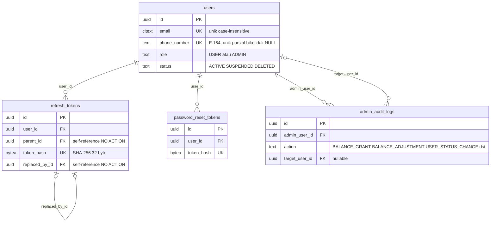
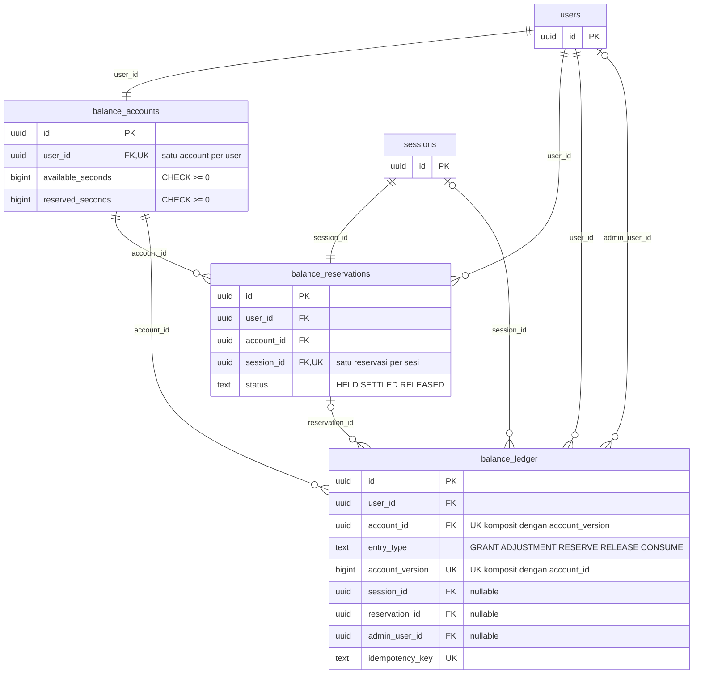
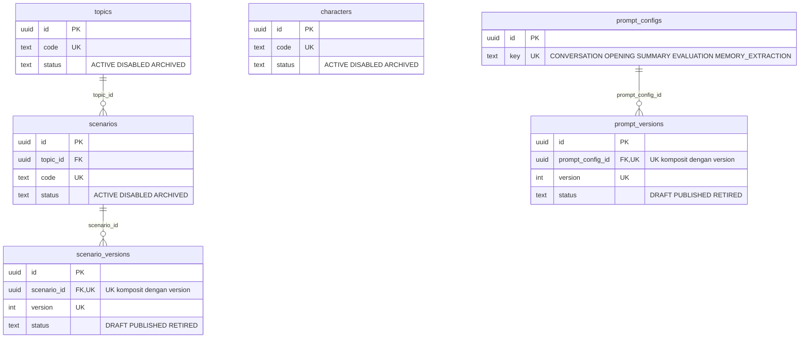
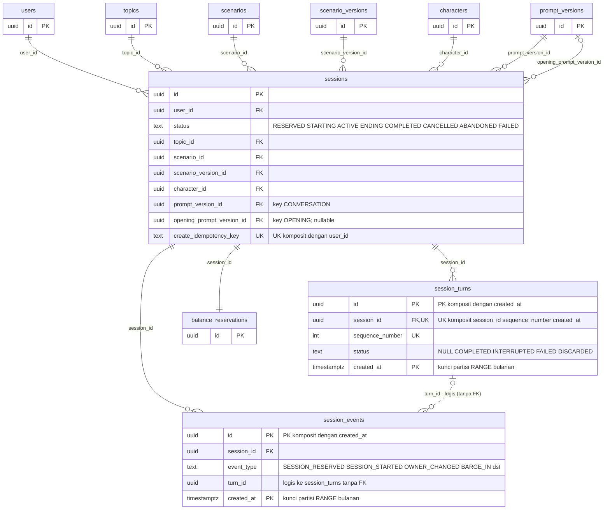
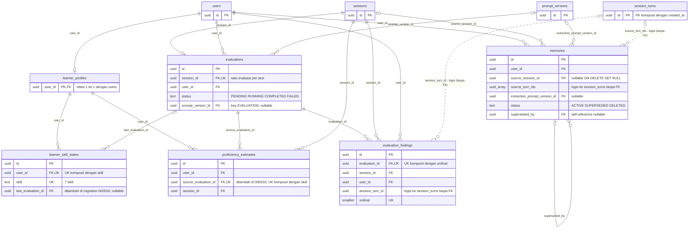
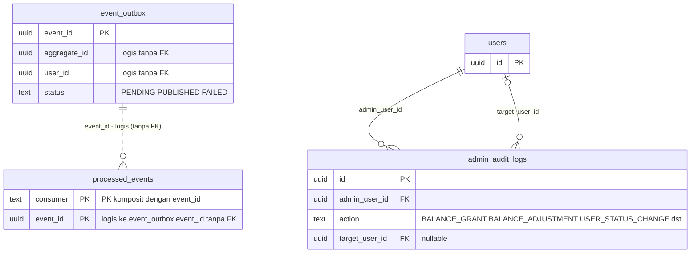

# ERD Database Kotoki

Sumber kebenaran: spec `docs/superpowers/specs/2026-10-12-kotoki-backend-design.md` (DDL per bab, indeks migration di Bab 15 §15.1). Dokumen ini memetakan migration `000001`-`000018` (000001 hanya extension `vector` dan `citext`) menjadi **24 tabel**.
Tabel `session_turns` dan `session_events` dipartisi RANGE bulanan pada `created_at`, sehingga **tidak ada FK yang menunjuk ke keduanya** (S-6); relasi ke keduanya bersifat logis dan digambar putus-putus (`..`) dengan label "logis (tanpa FK)".
Konvensi: tipe `numeric_5_2` berarti `NUMERIC(5,2)`; `text_array`/`uuid_array` berarti `TEXT[]`/`UUID[]`; `vector_1536` berarti `vector(1536)`. Kolom bertanda UK pada dua kolom atau lebih adalah bagian dari satu UNIQUE komposit (dijelaskan di komentar). Semua FK `ON DELETE RESTRICT` kecuali dinyatakan lain di §5.

## 1. Diagram lengkap (24 tabel)

```mermaid
erDiagram
    users {
        uuid id PK
        citext email UK "unik case-insensitive"
        text phone_number UK "E.164; unik parsial bila tidak NULL"
        text full_name
        text password_hash "argon2id PHC"
        text role "USER atau ADMIN"
        text status "ACTIVE SUSPENDED DELETED"
        timestamptz password_changed_at
        timestamptz last_login_at
        text terms_version
        timestamptz terms_accepted_at
        boolean audio_consent
        timestamptz audio_consent_updated_at
        timestamptz created_at
        timestamptz updated_at
        timestamptz deleted_at
        timestamptz purged_at
    }
    refresh_tokens {
        uuid id PK
        uuid user_id FK
        uuid family_id
        uuid parent_id FK "self-reference NO ACTION"
        bytea token_hash UK "SHA-256 32 byte"
        text user_agent
        inet ip_address
        timestamptz created_at
        timestamptz expires_at
        timestamptz revoked_at
        text revoke_reason "ROTATED LOGOUT REUSE_DETECTED PASSWORD_RESET USER_STATUS_CHANGED"
        uuid replaced_by_id FK "self-reference NO ACTION"
    }
    password_reset_tokens {
        uuid id PK
        uuid user_id FK
        bytea token_hash UK
        inet requested_ip
        timestamptz created_at
        timestamptz expires_at
        timestamptz used_at
        timestamptz invalidated_at
    }
    admin_audit_logs {
        uuid id PK
        uuid admin_user_id FK
        text action "BALANCE_GRANT BALANCE_ADJUSTMENT USER_STATUS_CHANGE dst"
        text target_type "USER SESSION TOPIC SCENARIO CHARACTER PROMPT"
        text target_id
        uuid target_user_id FK "nullable"
        text request_id
        text idempotency_key
        text reason
        jsonb details
        inet ip_address
        text user_agent
        timestamptz created_at
    }
    balance_accounts {
        uuid id PK
        uuid user_id FK, UK "satu account per user"
        bigint available_seconds "CHECK >= 0"
        bigint reserved_seconds "CHECK >= 0"
        bigint version
        timestamptz created_at
        timestamptz updated_at
    }
    balance_reservations {
        uuid id PK
        uuid user_id FK
        uuid account_id FK
        uuid session_id FK, UK "satu reservasi per sesi"
        bigint reserved_seconds "300 600 900 1800 2700 3600"
        bigint consumed_seconds
        bigint released_seconds
        text status "HELD SETTLED RELEASED"
        timestamptz start_deadline_at
        timestamptz created_at
        timestamptz settled_at
        timestamptz released_at
        timestamptz updated_at
    }
    balance_ledger {
        uuid id PK
        uuid user_id FK
        uuid account_id FK "UK komposit dengan account_version"
        text entry_type "GRANT ADJUSTMENT RESERVE RELEASE CONSUME"
        bigint available_seconds_delta
        bigint reserved_seconds_delta
        bigint available_seconds_after
        bigint reserved_seconds_after
        bigint account_version UK "UK komposit dengan account_id"
        uuid session_id FK "nullable"
        uuid reservation_id FK "nullable"
        text reference_type "SESSION ADMIN REGISTRATION"
        uuid admin_user_id FK "nullable"
        text reason
        text idempotency_key UK
        timestamptz created_at
    }
    topics {
        uuid id PK
        text code UK
        text name
        text name_ja
        text description
        text icon_key
        int sort_order
        text status "ACTIVE DISABLED ARCHIVED"
        timestamptz created_at
        timestamptz updated_at
    }
    scenarios {
        uuid id PK
        uuid topic_id FK
        text code UK
        text name
        text name_ja
        text description
        int sort_order
        text status "ACTIVE DISABLED ARCHIVED"
        timestamptz created_at
        timestamptz updated_at
    }
    scenario_versions {
        uuid id PK
        uuid scenario_id FK, UK "UK komposit dengan version"
        int version UK
        text status "DRAFT PUBLISHED RETIRED"
        smallint difficulty_level "1 sampai 5"
        numeric_2_1 recommended_level_min
        numeric_2_1 recommended_level_max
        text situation
        text ai_role
        text user_role
        text goal
        jsonb tasks
        jsonb constraints
        jsonb grammar_targets
        jsonb vocab_hints
        text_array evaluation_focus
        text formality "CASUAL POLITE KEIGO"
        text opening_line
        jsonb visual_prompt
        text notes
        timestamptz created_at
        timestamptz published_at
        timestamptz retired_at
    }
    characters {
        uuid id PK
        text code UK
        text status "ACTIVE DISABLED ARCHIVED"
        int sort_order
        text name
        text avatar_key
        text persona
        text greeting_hint
        text provider_name "ELEVENLABS CARTESIA DEEPGRAM OPENAI; TTS utama"
        text model_name "nama model TTS, teks bebas"
        text voice_id "ID suara di vendor, teks bebas"
        jsonb voice "gender accent speaking_rate fallback opsional"
        timestamptz created_at
        timestamptz updated_at
    }
    prompt_configs {
        uuid id PK
        text key UK "CONVERSATION OPENING SUMMARY EVALUATION MEMORY_EXTRACTION"
        text description
        timestamptz created_at
        timestamptz updated_at
    }
    prompt_versions {
        uuid id PK
        uuid prompt_config_id FK, UK "UK komposit dengan version"
        int version UK
        text status "DRAFT PUBLISHED RETIRED"
        text system_template
        text user_template
        jsonb output_schema
        jsonb llm_params
        text notes
        timestamptz created_at
        timestamptz published_at
        timestamptz retired_at
    }
    sessions {
        uuid id PK
        uuid user_id FK
        text status "RESERVED STARTING ACTIVE ENDING COMPLETED CANCELLED ABANDONED FAILED"
        text end_reason "USER_ENDED DURATION_ELAPSED RECONNECT_TIMEOUT PROVIDER_FAILURE SERVER_ERROR USER_CANCELLED NOT_STARTED"
        text conversation_start_mode "USER_FIRST AI_FIRST"
        int duration_seconds "300 600 900 1800 2700 3600"
        uuid topic_id FK
        uuid scenario_id FK
        uuid scenario_version_id FK
        uuid character_id FK
        uuid prompt_version_id FK "key CONVERSATION"
        uuid opening_prompt_version_id FK "key OPENING; nullable"
        jsonb config_snapshot
        jsonb adaptive_difficulty
        bigint runtime_fence
        int reserved_seconds
        int charged_seconds
        int disconnected_seconds
        text failure_detail
        text summary_text
        timestamptz transcript_purged_at
        text create_idempotency_key UK "UK komposit dengan user_id"
        bytea create_request_hash
        timestamptz created_at
        timestamptz starting_at
        timestamptz started_at
        timestamptz expires_at
        timestamptz ending_at
        timestamptz ended_at
        timestamptz handoff_at
        timestamptz updated_at
        bigint version
    }
    session_turns {
        uuid id PK "PK komposit dengan created_at"
        uuid session_id FK, UK "UK komposit session_id sequence_number created_at"
        int sequence_number UK
        text status "NULL COMPLETED INTERRUPTED FAILED DISCARDED"
        text user_text
        timestamptz user_started_at
        timestamptz user_ended_at
        text assistant_text
        text assistant_spoken_text
        int generation
        text stt_provider
        text llm_provider
        text llm_model
        text tts_provider
        text tts_model
        text tts_voice_id
        boolean used_fallback
        int turn_end_to_first_audio_ms
        int stt_final_ms
        int llm_first_token_ms
        int tts_first_audio_ms
        text user_audio_object_key
        int input_tokens
        int output_tokens
        int tts_characters
        int stt_audio_ms
        text error_code
        timestamptz created_at PK "kunci partisi RANGE bulanan"
        timestamptz completed_at
    }
    session_events {
        uuid id PK "PK komposit dengan created_at"
        uuid session_id FK
        text event_type "SESSION_RESERVED SESSION_STARTED OWNER_CHANGED BARGE_IN dst"
        text actor "USER REALTIME SWEEPER CLEANUP ADMIN SYSTEM"
        text from_status
        text to_status
        uuid turn_id "logis ke session_turns tanpa FK"
        jsonb payload
        timestamptz created_at PK "kunci partisi RANGE bulanan"
    }
    learner_profiles {
        uuid user_id PK, FK "relasi 1 ke 1 dengan users"
        text nickname
        text self_declared_level "BEGINNER N5 N4 N3 N2 N1"
        text target_level "N5 N4 N3 N2 N1"
        text learning_goal
        text learning_goal_note
        text preferred_speech_speed "SLOWER NORMAL FASTER"
        text preferred_formality "AUTO CASUAL POLITE"
        text dialect_preference "STANDARD_ONLY ALLOW_DIALECT"
        boolean memory_enabled
        timestamptz onboarding_completed_at
        timestamptz created_at
        timestamptz updated_at
    }
    learner_skill_states {
        uuid id PK
        uuid user_id FK, UK "UK komposit dengan skill"
        text skill UK "7 skill"
        numeric_3_2 prior_level
        numeric_4_3 prior_confidence
        numeric_3_2 estimated_level
        numeric_3_2 demonstrated_ceiling
        numeric_4_3 confidence
        text trend "INSUFFICIENT_DATA IMPROVING STABLE DECLINING"
        int evidence_count
        uuid last_evaluation_id FK "ditambah di migration 000016; nullable"
        timestamptz last_evidence_at
        timestamptz created_at
        timestamptz updated_at
    }
    proficiency_estimates {
        uuid id PK
        uuid user_id FK
        text skill
        uuid source_evaluation_id FK, UK "ditambah di 000016; UK komposit dengan skill"
        uuid session_id FK
        smallint algorithm_version
        numeric_5_2 raw_score
        smallint effective_difficulty
        numeric_3_2 evidence_level
        numeric_4_3 evidence_confidence
        numeric_3_2 previous_level
        numeric_3_2 estimated_level
        numeric_4_3 confidence
        int evidence_count
        text trend
        timestamptz assessed_at
        timestamptz created_at
    }
    evaluations {
        uuid id PK
        uuid session_id FK, UK "satu evaluasi per sesi"
        uuid user_id FK
        text status "PENDING RUNNING COMPLETED FAILED"
        boolean insufficient_evidence
        smallint grammar_score
        smallint vocabulary_score
        smallint fluency_score
        smallint naturalness_score
        smallint task_achievement_score
        smallint pronunciation_score
        numeric_5_2 overall_score
        smallint listening_response_signal
        smallint interaction_complexity_signal
        jsonb dimension_confidence
        jsonb dimension_comments
        text pronunciation_status "ASSESSED UNAVAILABLE SKIPPED"
        text pronunciation_unavailable_reason
        int pronunciation_utterance_count
        text summary_feedback
        jsonb strengths
        jsonb focus_areas
        jsonb recommendations
        int user_turn_count
        int user_speech_seconds
        int active_seconds
        smallint scenario_difficulty_level
        text rubric_version
        uuid prompt_version_id FK "key EVALUATION; nullable"
        text provider
        text model
        boolean used_fallback
        smallint llm_call_count
        int input_tokens
        int output_tokens
        text pronunciation_provider
        int attempt_count
        text failure_code
        text last_error
        uuid source_event_id "event session.completed"
        timestamptz details_purged_at
        timestamptz created_at
        timestamptz started_at
        timestamptz completed_at
        timestamptz updated_at
    }
    evaluation_findings {
        uuid id PK
        uuid evaluation_id FK, UK "UK komposit dengan ordinal"
        uuid session_id FK
        uuid user_id FK
        uuid session_turn_id "logis ke session_turns tanpa FK"
        int turn_sequence_number
        smallint ordinal UK
        text dimension "GRAMMAR VOCABULARY FLUENCY NATURALNESS TASK_ACHIEVEMENT PRONUNCIATION"
        text finding_type
        text severity "INFO MINOR MAJOR"
        text original_text
        text corrected_text
        text explanation
        text pattern_key
        numeric_3_2 confidence
        text source "LLM PRONUNCIATION_PROVIDER"
        timestamptz created_at
    }
    memories {
        uuid id PK
        uuid user_id FK
        text category "PROFILE_FACT PREFERENCE LEARNING_PATTERN EPISODIC"
        text memory_key "UK parsial user_id category memory_key"
        text content
        text display_text
        text evidence_type "EXPLICIT_USER_STATEMENT USER_CONFIRMED INFERRED USER_DELETED"
        numeric_4_3 confidence
        numeric_4_3 importance
        int observation_count
        uuid source_session_id FK "nullable ON DELETE SET NULL"
        uuid_array source_turn_ids "logis ke session_turns tanpa FK"
        uuid extraction_prompt_version_id FK "nullable"
        vector_1536 embedding
        text embedding_model
        text status "ACTIVE SUPERSEDED DELETED"
        uuid superseded_by FK "self-reference nullable"
        timestamptz first_observed_at
        timestamptz last_observed_at
        timestamptz expires_at
        timestamptz created_at
        timestamptz updated_at
    }
    event_outbox {
        uuid event_id PK
        text event_type "session.completed evaluation.completed evaluation.failed memory.extracted"
        int event_version
        text aggregate_type "SESSION EVALUATION"
        uuid aggregate_id "logis tanpa FK"
        uuid user_id "logis tanpa FK"
        text producer "API REALTIME WORKER"
        jsonb payload
        text traceparent
        text tracestate
        timestamptz occurred_at
        text status "PENDING PUBLISHED FAILED"
        int attempts
        timestamptz available_at
        text last_error
        timestamptz created_at
        timestamptz published_at
    }
    processed_events {
        text consumer PK "PK komposit dengan event_id"
        uuid event_id PK "logis ke event_outbox.event_id tanpa FK"
        text event_type
        timestamptz processed_at
    }
    users ||--o{ refresh_tokens : "user_id"
    refresh_tokens |o--o{ refresh_tokens : "parent_id"
    refresh_tokens |o--o| refresh_tokens : "replaced_by_id"
    users ||--o{ password_reset_tokens : "user_id"
    users ||--o{ admin_audit_logs : "admin_user_id"
    users |o--o{ admin_audit_logs : "target_user_id"
    users ||--|| balance_accounts : "user_id"
    users ||--o{ balance_reservations : "user_id"
    balance_accounts ||--o{ balance_reservations : "account_id"
    sessions ||--|| balance_reservations : "session_id"
    users ||--o{ balance_ledger : "user_id"
    balance_accounts ||--o{ balance_ledger : "account_id"
    sessions |o--o{ balance_ledger : "session_id"
    balance_reservations |o--o{ balance_ledger : "reservation_id"
    users |o--o{ balance_ledger : "admin_user_id"
    topics ||--o{ scenarios : "topic_id"
    scenarios ||--o{ scenario_versions : "scenario_id"
    prompt_configs ||--o{ prompt_versions : "prompt_config_id"
    users ||--o{ sessions : "user_id"
    topics ||--o{ sessions : "topic_id"
    scenarios ||--o{ sessions : "scenario_id"
    scenario_versions ||--o{ sessions : "scenario_version_id"
    characters ||--o{ sessions : "character_id"
    prompt_versions ||--o{ sessions : "prompt_version_id"
    prompt_versions |o--o{ sessions : "opening_prompt_version_id"
    sessions ||--o{ session_turns : "session_id"
    sessions ||--o{ session_events : "session_id"
    session_turns |o..o{ session_events : "turn_id - logis (tanpa FK)"
    users ||--o| learner_profiles : "user_id"
    learner_profiles ||--o{ learner_skill_states : "user_id"
    learner_profiles ||--o{ proficiency_estimates : "user_id"
    evaluations ||--o{ proficiency_estimates : "source_evaluation_id"
    evaluations |o--o{ learner_skill_states : "last_evaluation_id"
    sessions ||--o{ proficiency_estimates : "session_id"
    sessions ||--o| evaluations : "session_id"
    users ||--o{ evaluations : "user_id"
    prompt_versions |o--o{ evaluations : "prompt_version_id"
    evaluations ||--o{ evaluation_findings : "evaluation_id"
    sessions ||--o{ evaluation_findings : "session_id"
    users ||--o{ evaluation_findings : "user_id"
    session_turns |o..o{ evaluation_findings : "session_turn_id - logis (tanpa FK)"
    users ||--o{ memories : "user_id"
    sessions |o--o{ memories : "source_session_id"
    prompt_versions |o--o{ memories : "extraction_prompt_version_id"
    memories |o--o{ memories : "superseded_by"
    session_turns |o..o{ memories : "source_turn_ids - logis (tanpa FK)"
    event_outbox ||..o{ processed_events : "event_id - logis (tanpa FK)"
```

Catatan baca: `||--o{` = satu ke nol-atau-banyak; `|o--o{` = FK opsional (nullable); `||--||` / `||--o|` = relasi satu ke satu (kolom FK unik). Garis putus-putus = relasi logis tanpa FK fisik. `event_outbox` juga punya `aggregate_id` dan `user_id` tanpa FK (outbox adalah infrastruktur) dan tidak digambar agar diagram tidak penuh.

## 2. Diagram per domain (kolom kunci saja)

### 2.1 Identity & Auth



### 2.2 Balance



### 2.3 Content (topics, scenarios, characters, prompts)



### 2.4 Session



### 2.5 Learning



### 2.6 Messaging & Audit



Entitas dengan hanya satu kolom (`id`) pada diagram domain adalah tabel dari domain lain yang ditampilkan sebagai referensi.

## 3. Tabel, migration, dan bab spec

| Tabel | Migration | Bab spec |
|---|---|---|
| `users` | 000002_users | Bab 3 §3.3.1 |
| `refresh_tokens` | 000003_auth_tokens | Bab 3 §3.3.2 |
| `password_reset_tokens` | 000003_auth_tokens | Bab 3 §3.3.2 |
| `balance_accounts` | 000004_balance_accounts | Bab 4 §4.3.1 |
| `topics` | 000005_topics | Bab 6 §6.4.1 |
| `scenarios` | 000006_scenarios | Bab 6 §6.4.2 |
| `scenario_versions` | 000006_scenarios | Bab 6 §6.4.2 |
| `characters` | 000007_characters | Bab 6 §6.4.3 |
| `prompt_configs` | 000008_prompts | Bab 6 §6.4.4 |
| `prompt_versions` | 000008_prompts | Bab 6 §6.4.4 |
| `sessions` | 000009_sessions | Bab 5 §5.3.1 |
| `session_turns` | 000010_session_turns | Bab 5 §5.3.2 |
| `session_events` | 000011_session_events | Bab 5 §5.3.3 |
| `balance_reservations` | 000012_balance_reservations | Bab 4 §4.3.2 |
| `balance_ledger` | 000013_balance_ledger | Bab 4 §4.3.3 |
| `learner_profiles` | 000014_learner | Bab 12 §12.2.1 |
| `learner_skill_states` | 000014_learner | Bab 12 §12.2.2 |
| `proficiency_estimates` | 000014_learner | Bab 12 §12.2.3 |
| `memories` | 000015_memories | Bab 11 §11.3 |
| `evaluations` | 000016_evaluations | Bab 10 §10.2 |
| `evaluation_findings` | 000016_evaluations | Bab 10 §10.2 |
| `event_outbox` | 000017_messaging | Bab 9 §9.2.1 |
| `processed_events` | 000017_messaging | Bab 9 §9.2.2 |
| `admin_audit_logs` | 000018_admin_audit | Bab 3 §3.3.3 |

Total: 24 tabel. Migration `000001_extensions` tidak membuat tabel. Migration `000016` juga menambah FK `learner_skill_states.last_evaluation_id` (ON DELETE SET NULL) dan `proficiency_estimates.source_evaluation_id` (ON DELETE CASCADE) ke `evaluations` (§12.2.4).

## 4. Catatan constraint penting

- **Satu sesi terbuka per user**: `ux_sessions_one_open_per_user` = UNIQUE (`user_id`) WHERE `status` IN (RESERVED, STARTING, ACTIVE, ENDING).
- **Satu version PUBLISHED per induk**: `ux_scenario_versions_published` (per `scenario_id`) dan `ux_prompt_versions_published` (per `prompt_config_id`), keduanya WHERE `status = 'PUBLISHED'`. Version konten immutable lewat trigger `content_version_guard()`. `characters` tidak berversi (histori ada di `sessions.config_snapshot`).
- **Idempotency**: `ux_sessions_user_idempotency` UNIQUE (`user_id`, `create_idempotency_key`); `balance_ledger.idempotency_key` UNIQUE (`ux_balance_ledger_idempotency`) dengan pola `grant:`/`adjust:`/`reserve:<id>`/`release:<id>`; `balance_ledger` UNIQUE (`account_id`, `account_version`); `admin_audit_logs.idempotency_key` bersifat opsional (tanpa UNIQUE); `processed_events` PK (`consumer`, `event_id`) untuk dedup consumer.
- **Satu-ke-satu**: `balance_accounts.user_id` UNIQUE; `balance_reservations.session_id` UNIQUE; `evaluations.session_id` UNIQUE; `learner_profiles.user_id` adalah PK sekaligus FK.
- **Append-only**: `balance_ledger` dan `admin_audit_logs` memakai trigger `reject_mutation()` (BEFORE UPDATE OR DELETE). Fungsi dibuat di migration 000013 dan dipakai ulang di 000018.
- **Partisi**: `session_turns` dan `session_events` PARTITION BY RANGE (`created_at`) bulanan (`..._pYYYYMM`, bulan berjalan + 3 bulan ke depan). PK komposit (`id`, `created_at`); `session_turns` UNIQUE (`session_id`, `sequence_number`, `created_at`). Integritas `evaluation_findings.session_turn_id`, `session_events.turn_id`, dan `memories.source_turn_ids` dijaga aplikasi karena turn bisa terhapus retensi transcript (180 hari).
- **Tanpa FK (infrastruktur)**: `event_outbox.user_id`/`aggregate_id`; `processed_events.event_id` secara logis mengacu `event_outbox.event_id`.
- **Memory**: `ux_memories_active_slot` UNIQUE (`user_id`, `category`, `memory_key`) WHERE ACTIVE, dan `ux_memories_tombstone_slot` WHERE DELETED. Embedding `vector(1536)` tanpa index HNSW (exact scan per user, §11.3.1).
- **Users**: `email` CITEXT UNIQUE; `phone_number` UNIQUE parsial (WHERE NOT NULL). Baris `users` tidak pernah di-DELETE fisik; FK RESTRICT dari ledger, sessions, dan audit. `evaluations`, `evaluation_findings`, `memories`, `learner_*` memakai CASCADE ke `users` (SET NULL untuk `memories.source_session_id`).
- **Balance**: CHECK `available_seconds >= 0` dan `reserved_seconds >= 0`; `balance_reservations.reserved_seconds` IN (300, 600, 900, 1800, 2700, 3600).
